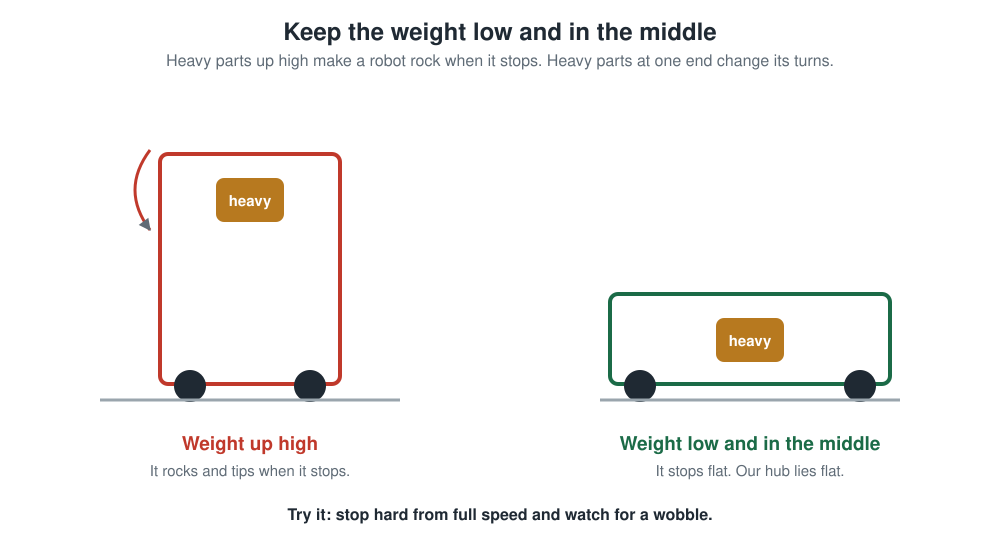
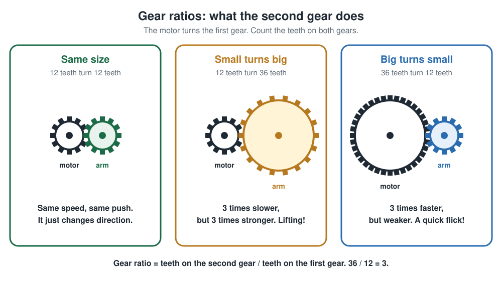
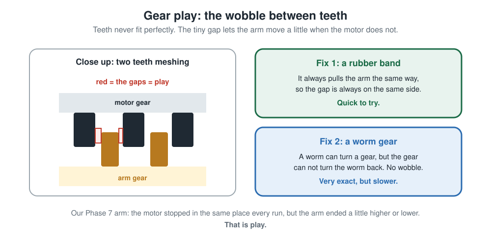
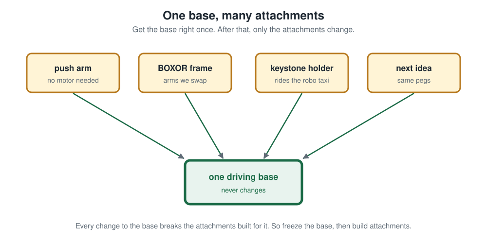
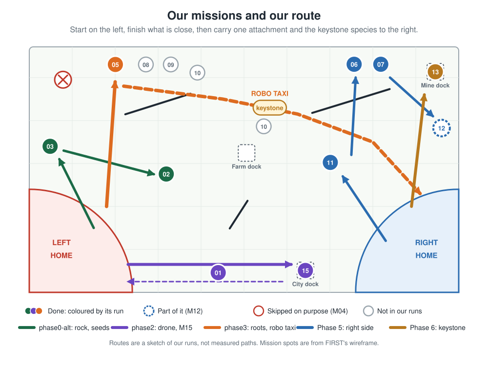

# Robot Design: Going for Exceeds

This is the Bumble Bots plan for Exceeds (4) on all ten Robot Design rubric
lines. It covers what judges look for, how to show our engineering, how to test
and record it, and how to explain it in the room.

Read [Our Robot, Explained](our-robot-explained.md) and
[How Our Code Is Designed](how-our-code-works.md) first. This page builds on
them. The class slides are in the [Exceeds workshop](exceeds-workshop.html).

**How to read this page.** Three markers keep facts apart from advice:

- **Official:** words from FIRST's BIOGLOW Robot Design rubric or the official
  judging materials in `docs/official-materials/`. These are rules.
- **Our advice:** what we think helps, from coaching experience and how judges
  usually work. It is not a rule, and nothing guarantees Exceeds.
- **Example only:** made-up numbers that show what a table looks like. They are
  not our results. Replace them with real measurements. Tables marked **Our
  data** are real, from our code and our test runs.

**On this page:**

- [Our key facts](#our-key-facts)
- [1. The ten rubric lines](#1-the-ten-rubric-lines)
- [2. Mechanical engineering](#2-mechanical-engineering)
- [3. Programming](#3-programming)
- [4. Testing and iteration](#4-testing-and-iteration)
- [5. The engineering notebook](#5-the-engineering-notebook)
- [6. The five-minute explanation](#6-the-five-minute-explanation)
- [7. Judge questions](#7-judge-questions)
- [8. Exceeds readiness scorecard](#8-exceeds-readiness-scorecard)

## Our key facts

These are the facts every member should know. The strategy quiz and the
speaking scripts are built from this list, so if a fact changes, change it here
first.

**Our biggest limit is time.** A match is 2 minutes 30 seconds. Almost every
choice below was made to save time.

**Mission strategy**

- We do the missions closest to our home first. Short trips are quicker and more
  reliable.
- We do several missions with the same attachment, so we stop to swap less often.
- **The robo taxi:** the attachments and the keystone species wait on the left.
  phase3 does a mission on the way across the mat, M05 Reaching Roots, then
  carries one attachment and the keystone species to the right side. The keystone
  species goes on the Mine dock for M13. The rulebook gives M13 30 points.
- phase2 does M01 Drone Survey and M15 Biocentric Architecture with one straight
  push and back, so it is very reliable.
- We skipped M04 Lucky Leaves: far away, partly luck, and only 10 or 20 points.

**The robot**

- A flat robot with straight walls. It lines up against the field wall and with
  the lines on the mat, so every run starts straight.
- The hub has six ports: two for the wheel motors, two for the attachment motors,
  and two for colour sensors.
- **Push and pull before motors.** Where we can, an attachment just pushes or
  pulls. A motor can go wrong; a push can't.
- **Gravity mounting.** Pegs line the attachment up and its own weight holds it.
  Last season, changing attachments took a long time. Now it is one move.
- **The stopper.** A motor arm always starts resting on its stopper, so it starts
  from the same fixed point every run, and every move ends in the same place.

**The code**

- **Python, to reuse code.** Last year's team left us Python. Our drive command,
  `drive_cm`, came from it. We only changed the wheel size, from 88 mm to 62.4 mm.
  Python also gives us more control over every number.
- **Only the gyroscope steers.** The two colour sensors are plugged in, but we
  don't use them, or any light sensor, to steer.
- **Yaw** is the direction the robot is pointing, in degrees, like a compass. The
  gyroscope in the hub measures it.
- **The gyroscope in three steps:**
    1. **Zero the yaw** at the start of every mission program, so the way the
       robot points becomes 0.
    2. **Turn with the gyroscope.** `face(90)` turns until the yaw says 90 degrees
       from that start, so small mistakes don't add up.
    3. **Drive straight.** Every 15 milliseconds the robot checks the yaw. If it
       has drifted, it steers back, harder the further off it is.

## 1. The ten rubric lines

**Official.** The Robot Design rubric has five rows: IDENTIFY, DESIGN, CREATE,
ITERATE and COMMUNICATE. Each row has two lines, so there are ten lines. For
each line the judges tick Beginning (1), Developing (2), Accomplished (3) or
Exceeds (4). The rubric says: "If the team EXCEEDS, a short comment in the
exceeds column is required." It gives no set words for Exceeds.

**Official.** Five lines have a gear-shaped box. They count for Robot Design and
for Core Values: use of resources, all members contributed ideas, improvements
based on testing, and both COMMUNICATE lines.

**Our advice.** Because the judge must write why we exceeded, Exceeds usually
goes to a team that gives the judge something specific to write: a measured
number, a true before-and-after story, or a thing they can see on the table.
Accomplished has to be there first. A team can't skip a level.

Each line below follows the same pattern. The Accomplished words are official.
Everything under them is our advice.

### Line 1: Mission strategy (IDENTIFY)

**Official, Accomplished (3):** "Clear evidence of mission strategy."

**What Exceeds could look like.** Every team member can explain why we do each
mission and why we skip the others, with numbers: points, seconds and how often
it works. The strategy has a clear idea behind it, not just a list.

**Evidence that shows it.**

- The [mission map](diagrams/mission-route.svg) with our runs drawn on it.
- A missions table with points, seconds and works out of 10 for each run.
- Skipped missions with a reason in numbers.

**Strong student work (ours).** Our strategy has one idea: start on the left,
finish what is close, then carry one attachment and the keystone species to the
right as a robo taxi. From the Robot Design test: "only worth 10 points ... it
would work 30% of the time so we figured it was not worth it."

**Common mistakes.** "We did the easy ones." "It was too hard." A list of
missions with no reason. Different team members giving different mission lists.

**How to improve.** Agree one missions table as a team. Time each run. Run each
one 10 times. Then every member practises explaining one skipped mission.

**Judges might ask:** Why these missions? Why that order? What would you add
with more time?

**Strong answer:** "We start on the left and finish the missions close to home,
because short trips are reliable. Then phase3 drives to the right carrying our
attachment and the keystone species, so the robot doesn't come back to the left
for them. We skipped Lucky Leaves: it's far away, partly luck, and only 10 or 20
points."

### Line 2: Use of resources (IDENTIFY, gear line)

**Official, Accomplished (3):** "Clear use of building or coding resources to
support their mission strategy."

**What Exceeds could look like.** We used resources on purpose, compared them,
and can say what we took and what we changed.

**Evidence that shows it.** The [six designs comparison](chassis-designs-slides.html),
the wheel pattern we found, last year's Python code, and the published BOXOR
attachment frame.

**Strong student work (ours).** We compared six driving bases and saw that the
three that slipped all used the blue SPIKE wheels. We kept last year's `drive_cm`
and changed only the wheel size, from 88 mm to 62.4 mm.

**Common mistakes.** "We looked online." "We copied a robot." Hiding that we
used someone else's design. The rubric says "improved on existing ones", so
using a design is fine. Say what we changed.

**How to improve.** For each resource, write one line: what it is, what we took,
what we changed, and why.

**Judges might ask:** Where did your ideas come from? Did you design this
yourselves?

**Strong answer:** "We started from published designs. We compared six driving
bases before building, and the BOXOR attachment frame is a published design too.
We changed it: one arm became two arms, so one attachment does missions 1 and 2."

### Line 3: Contributions of all team members (DESIGN, gear line)

**Official, Accomplished (3):** "Clear evidence that all team members contributed
ideas."

**What Exceeds could look like.** Each member names an idea they had that is on
the robot now, and teammates can explain each other's ideas.

**Evidence that shows it.** The [who did what](../docs/who-did-what.md) record,
dated notebook entries with a name or slot, and everyone speaking in the room.

**Common mistakes.** One student answers everything. "We all did everything."
Nobody can say whose idea something was.

**How to improve.** Each member writes "an idea I had" on homework slide T10.
In practice, the coach asks one member about another member's idea.

**Judges might ask:** Whose idea was the robo taxi? Did you ever disagree?

**Strong answer shape:** "We disagreed about **[what]**. We tried **[both
ideas]**, tested them, and picked **[which]** because **[result]**." Use a real
disagreement. From our test: when there is an argument, the team votes.

### Line 4: Building and coding skills (DESIGN)

**Official, Accomplished (3):** "Clear evidence of building and coding skills in
all team members."

**What Exceeds could look like.** Every member has built something and coded
something, and can show it without help.

**Evidence that shows it.** A build and a code example for each member, git
history, and members explaining a line of code they wrote.

**Common mistakes.** Builders who never coded and coders who never built. "I
helped with stuff."

**How to improve.** Anyone missing a build or a code example gets a small job
before judging: tune one `#was` number, or rebuild one arm.

**Judges might ask:** Show me something you built. Explain one line you wrote.

**Strong answer:** "I built the keystone species holder. I coded the start of
missions 3, 2 and 1. This line, `await face(0)`, straightens the robot after it
hits the rock."

### Line 5: Attachments and their purpose (CREATE)

**Official, Accomplished (3):** "Clear explanation of innovative attachments and
their purpose."

**What Exceeds could look like.** We explain what each attachment does, why it
is built that way, what we changed after testing, and we can show the old
version.

**Evidence that shows it.** The attachments on the table, before-and-after
photos, a timed swap, and the [gravity mounting diagram](diagrams/gravity-mount.svg).

**Strong student work (ours).** The BOXOR frame's bevel gears turn the motor's
movement through 90 degrees to swing an arm. Attachments sit on pegs, held by
their own weight, so a swap is one move. We chose that because last season's
swaps were slow. Where we can, we use a simple push instead of a motor, because
a push can't go wrong the way a motor can.

**Common mistakes.** Describing what it does, not why. No before version. Saying
"we invented it" about a published design.

**How to improve.** Time five swaps and use the middle one. Keep the old version
of one attachment to show.

**Judges might ask:** Why gravity mounting? Has an attachment fallen off? Why on
the back?

**Strong answer:** "Gravity mounting is one move: lower it onto the pegs. Last
season clipping attachments on took a long time. The catch is that a strong push
can lift it off. When we tried pushing our arm into its stopper, the attachment
lifted, so we stopped doing that."

### Line 6: Code and sensor use (CREATE)

**Official, Accomplished (3):** "Clear explanation of innovative code and/or
sensor use."

**What Exceeds could look like.** We explain how our code uses the gyro, with
our own numbers, and why we made each choice.

**Evidence that shows it.** The [gyro loop](diagrams/gyro-loop.svg), the turn
test numbers, and the safety stops.

**Strong student work (ours).** `drive_cm` reads the gyro about 66 times a second
and steers back: `trim = -(18.9 x error + 5.25 x change)`. `face` measures every
turn from base, so a square ends about 1 degree off instead of 17. We measured
the gyro turn against the old wheel-counting turn and deleted the slower one.

**Common mistakes.** "We used the gyro." Big words like PID with no idea what
they mean. No numbers.

**How to improve.** Each coder practises the 5-degree example: drift 5 degrees
left, the error is -5, trim is +94, so the robot steers back right.

**Judges might ask:** How does it drive straight? Why not the colour sensor?
What happens if the gyro is wrong?

**Strong answer:** "Every 15 milliseconds it reads the gyro. If we've drifted,
it speeds up one wheel and slows the other, more the further off we are. If it
ever gets 45 degrees off, it stops, because that means something is wrong."

### Line 7: Testing (ITERATE)

**Official, Accomplished (3):** "Clear evidence of repeated testing of their robot
and code."

**What Exceeds could look like.** We test the same way every time, write down
the results, and give numbers without being asked.

**Evidence that shows it.** Run logs with dates, success counts out of 10, the
34 automatic code checks, and the printed arm logs.

**Common mistakes.** "We tested it a lot." Testing without writing it down.
Changing three things at once.

**How to improve.** Use the tables in [section 4](#4-testing-and-iteration). Ten
runs per program before judging.

**Judges might ask:** How do you know it's reliable? What's your success rate?

**Strong answer:** "We run each program 10 times and write down how many work.
phase2 is one straight push and back, which is why it is so reliable."

### Line 8: Improvements (ITERATE, gear line)

**Official, Accomplished (3):** "Clear evidence of improvements based on testing."

**What Exceeds could look like.** We show a problem we measured, what we changed,
and a number that got better. We include ideas that failed.

**Evidence that shows it.** `#was` notes in the code, the arm log table, and the
design log.

**Strong student work (ours).** The Phase 7 arm was sometimes too high. We printed
the motor position after every move and found two runs started 45 degrees
apart. Our first fix broke when the attachment went back on. Our second fix
lifted the attachment. The third, using the stopper as zero, worked even after
re-seating.

**Common mistakes.** Only success stories. "We fixed it" with no measurement.

**How to improve.** Every member learns one fix story with four parts: problem,
how we found out, what we changed, result with a number.

**Judges might ask:** Show me something you changed. What didn't work?

**Strong answer:** see the arm story above. Two failed tries make it stronger,
not weaker.

### Line 9: Engineering process and lessons learned (COMMUNICATE, gear line)

**Official, Accomplished (3):** "Detailed explanation of process and lessons
learned."

**What Exceeds could look like.** We describe how we work: research, build,
test, measure, change, and test again. Each member says a lesson in their own
words.

**Evidence that shows it.** The notebook, the design log, and the order of our
story in the five minutes.

**Common mistakes.** Lessons that are just events: "we went to a competition."
Everyone saying the same lesson.

**How to improve.** Each member writes one lesson as "we learned that ... because
...".

**Judges might ask:** What would you do differently? What was the hardest part?

**Strong answer:** "We learned to measure before we fix. With the arm we guessed
twice and were wrong. The printed numbers showed the real cause."

### Line 10: Team pride and enthusiasm (COMMUNICATE, gear line)

**Official, Accomplished (3):** "Team clearly shows pride or enthusiasm for their
work."

**What Exceeds could look like.** Everyone is keen to show their part, shares
credit, and handles a hard question calmly.

**Common mistakes.** Reading from cards. One member doing all the talking. A
flat voice.

**How to improve.** Practise until it sounds like a conversation. Each member
picks the thing they are proudest of.

**Strong answer (from our test):** "I am so proud that we were one time top of
the table in our competition that had 32 teams."

## 2. Mechanical engineering

Eight ideas about how our robot is built. Each one has a picture, a few short
lines, and what to say to a judge. All of this is **our advice**.

<div class="grid cards" markdown>

-   **1. A flat box**

    Pushed against a wall, it can only sit square.

-   **2. Weight low**

    Heavy parts low and in the middle, so it doesn't rock.

-   **3. Grippy wheels**

    The designs that slipped all had blue wheels.

-   **4. Gears**

    Count the teeth. Slower and stronger, or faster and weaker.

-   **5. One base**

    Get the base right once. Then only attachments change.

-   **6. Clever, not complicated**

    The robo taxi, gravity mounting, and pushing instead of a motor.

-   **7. Same every time**

    Same start, same stopper, same pegs.

-   **8. Say why**

    "We chose ... because ... We tested ... and got ..."

</div>

### Driving base

{ loading=lazy }

- Our robot is a **flat box** with straight walls.
- Push it back against the wall, and it can only sit **square**.
- The wheels sit **inside the frame**, held on both sides.

!!! tip "Say it to a judge"
    "Our robot is a flat box. Push it against the wall and it sits square, so
    every run starts the same way. It lines up with the lines on the mat too."

### Stability and weight distribution

{ loading=lazy }

- Heavy parts go **low** and in the **middle**.
- Our hub lies flat, face up.
- **Try it:** stop hard from full speed. Does it wobble? Write down where the
  heaviest part is.

!!! tip "Say it to a judge"
    "We kept the heavy parts low, so the robot stops flat instead of rocking."

### Wheel configuration

{ loading=lazy }

- The three designs that **slipped** all had blue SPIKE wheels.
- So we use grippy wheels. Our code expects them to be **62.4 mm** across.
- **Try it:** measure our wheels with a ruler. Check `WHEEL_D_MM = 62.4` in
  `code/library/advanced.py`.

!!! tip "Say it to a judge"
    "We compared six designs. The ones that slipped all had blue wheels, so we
    chose grippy ones."

### Gear ratios and mechanical advantage

{ loading=lazy }

- **Count the teeth** on both gears.
- **Gear ratio = teeth on the second gear / teeth on the first.**
- Small gear turns a big one: **slower, but stronger**. Good for lifting.
- Big gear turns a small one: **faster, but weaker**. Good for a quick flick.

**To do:** count the teeth on the BOXOR frame's bevel gears. If both have the
same number, the ratio is 1, and the gears just turn the movement round a
corner.

**Gear play** is the little wobble between teeth.

{ loading=lazy }

- Our Phase 7 arm showed it. The motor stopped in the same place every run, but
  the arm ended a little higher or lower.
- **Fix 1:** a rubber band pulls the arm one way, so the gap is always on the
  same side.
- **Fix 2:** a worm gear can't be pushed backwards, so it doesn't wobble.

!!! tip "Say it to a judge"
    "Our bevel gears have __ and __ teeth, so the ratio is __. We found a little
    play in the arm by printing the motor's position, and we're fixing it with
    a rubber band."

### Modular, quick and multi-purpose attachments

{ loading=lazy }

{ loading=lazy }

- **One base, many attachments.** Every change to the base breaks the
  attachments, so freeze the base first.
- **Gravity mounting:** drop the attachment on the pegs, one move. Last season,
  swaps were slow.
- **One attachment, several missions**, so we swap less.

!!! tip "Say it to a judge"
    "Our attachments drop onto pegs and their weight holds them, so a swap is
    one move. It takes __ seconds."

### Innovative mechanisms

{ loading=lazy }

- **Innovative** means a clever answer to *our* problem, not a complicated
  machine.
- Our three: the **robo taxi**, **gravity mounting**, and a **push instead of a
  motor**.
- A push can't go wrong the way a motor can.

!!! tip "Say it to a judge"
    "Our cleverest idea is the robo taxi. One trip carries the attachment and the
    keystone species to the right, so the robot doesn't come back for them."

### Repeatability, reliability and alignment

Do this before every run:

| | Check |
| --- | --- |
| ☐ | Robot square against the **same wall**, in the **same spot** |
| ☐ | Motor arm resting on its **stopper** |
| ☐ | Attachment pressed down on its **pegs** |
| ☐ | A **push** instead of a motor wherever it works |

!!! tip "Say it to a judge"
    "Every run starts the same way: square on the wall, arm on the stopper. That's
    why it does the same thing every time."

### How to justify a design choice

Use this sentence for any choice:

!!! example "The sentence"
    "We chose **___** because **___**. We tested **___**, and the result was
    **___**."

**Example:** "We chose **gravity mounting** because **last season, swaps took a
long time**. We **timed a swap**, and it takes **__ seconds**." Fill in the real
time.

## 3. Programming

Everything in this section is **our advice**, with our code as the example. The
code is in `code/library/advanced.py`.

### How our code is organised

```
Run programs     phase0-alt.py, phase2.py, phase3.py, Phase 5.py, Phase 6.py, Phase 7.py
                 say WHAT to do: drive_cm(-44), face(90), arm_to(300)
        |
Our library      advanced.py
                 says HOW: speed ramps, gyro steering, turns, safety stops
        |
The SPIKE hub    motors, gyro, wheel encoders
```

Each run file carries a copy of the library, because the SPIKE app can't load one
file from another. `tools/build-mission.py` copies it in, so the copies can't
drift apart.

To test these ideas on the pretend robot, with our real library, do the
[simulator quiz](../code/learn/15-code-quiz.md).

### Gyro navigation and heading correction

**Yaw** is the direction the robot is pointing, in degrees, like a compass. We
use the gyroscope in three steps: zero the yaw at the start of each mission
program, turn with the gyroscope, and keep the robot driving straight.

Driving straight, simplified from `drive_cm`:

```
start: work out how many wheel degrees the distance needs
repeat every 15 ms:
    error = how far off straight the gyro says we are
    if error is more than 45 degrees: brake and stop with an error
    trim  = -(18.9 x error + 5.25 x (error - last error))
    left wheel  = speed + trim
    right wheel = speed - trim
until the wheels have turned far enough
brake a little early, because the robot rolls on
```

Turning, simplified from `face`:

```
target = the direction we want, measured from base
repeat every 15 ms:
    error = target - where we point now
    if error is under 1 degree: brake
    speed = 7.35 x error + 0.0105 x (error added up) + 1.05 x (change in error)
    never slower than 126, or the wheels only buzz
after braking, wait 0.15 s and check again, up to two more times
```

### PID, in plain words

- **P (proportional):** far from the target, push hard. Close, push gently.
- **I (integral):** stuck a little short for a while? Push a little more.
- **D (derivative):** closing in fast? Ease off, so it doesn't swing past.

`drive_cm` uses P and D. `face` uses all three.

### Colour sensors, distance sensors and line following

Our robot steers with the gyro and the wheel encoders. Two colour sensors are
plugged into the hub, but only the gyroscope steers: the team stopped using the
colour sensors on 20 September. Our code doesn't use a distance sensor.

Not using a sensor is fine, if we can say why. A colour sensor helps most when
the gyro can't fix a position, for example to stop exactly on a line. Simple
line following, as an idea:

```
repeat:
    reading = colour sensor reflection, 0 to 100
    error = reading - 50          (50 = half on the line, half off)
    steer by 0.5 x error
until we have gone far enough, or a timeout
```

The timeout matters. Our old Word Blocks waited for a line forever: one missed
line and the robot sat still for the rest of the match.

### Sensor-based positioning and calibration

- **Walls:** back gently into a wall to fix the direction and the distance.
- **Distance calibration:** we asked for 180 cm and got 179 cm, so every program
  has `set_calibration_scale(179/180)`.
- **Gyro direction:** `YAW_SIGN = -1`, measured on 20 September with
  `bench_check_yaw_sign()`.
- **Attachment zero:** Phase 7 makes the arm's stopper its zero at the start of
  every run.

### Error recovery

| What goes wrong | What our code does |
| --- | --- |
| A distance longer than the 200 cm mat | Refuses, because it is millimetres typed by mistake |
| A straight drive more than 45 degrees off | Brakes and stops with an error |
| A turn getting further from its target | Brakes and stops with an error |
| A drive or turn taking over 8 seconds | Gives up and goes on |
| An attachment move blocked | `run_for_degrees` reports `motor.STALLED`, and Phase 7 prints it |

### Consistent mission execution

- The same start position every run, squared on the wall.
- `face` measures from base, so small errors don't add up.
- Short runs and simple pushes, like phase2.
- One change at a time, then test again.

## 4. Testing and iteration

Everything in this section is **our advice**. Some tables are our real data,
and they are marked.

### The method

1. Decide what you are measuring before you start.
2. Change one thing only.
3. Run at least 10 times, set up the same way each time.
4. Write every result down, including the failures.
5. Compare with the runs before the change.

### Mission success rates

**Example only, not our data.** Fill in the real numbers.

| Run | Missions | Tries | Worked | Rate | Date |
| --- | --- | --- | --- | --- | --- |
| phase0-alt | M03, M02 | 10 | 8 | 80% | __ |
| phase2 | M01, M15 | 10 | 10 | 100% | __ |
| phase3 | M05, robo taxi | 10 | 7 | 70% | __ |

### Heading accuracy

**Our data,** from the turn test written up in How Our Code Is Designed.

| Turn method | Time | How far off |
| --- | --- | --- |
| Old turn, counting wheel degrees | 1.54 s | 4.26 degrees |
| Gyro turn | 1.18 s | 0.58 degrees |

**Our data:** four turns round a square end about 17 degrees off turning by 90
each time, and about 1 degree off with `face`.

### Distance accuracy

**Our data:** `drive_cm(180)` drove 179 cm, which gave the 179/180 calibration.

**Example only,** for a repeat test:

| Asked for | Run 1 | Run 2 | Run 3 | Run 4 | Run 5 | Average |
| --- | --- | --- | --- | --- | --- | --- |
| 30 cm | 30.1 | 29.8 | 30.0 | 30.2 | 29.9 | 30.0 |

### Attachment reliability

**Our data,** Phase 7 arm, first move, 21 November.

| What we tried | Runs | Motor ended in the same place? | Arm right? |
| --- | --- | --- | --- |
| Zero wherever the arm was at the start | 2 | No: starts 45 degrees apart | 1 of 2 |
| Zero from the motor's own angle | 6 | Yes, within 2 degrees, until the attachment went back on | 5 of 6, then wrong after re-seating |
| Push into the stopper to find zero | 1 | Not tested | No: it lifted the attachment |
| The stopper is zero | 4 | Yes | 2 good, 1 a little high, 1 too low |

The last row shows play in the mechanics: the motor did the same thing every
time, but the arm didn't. That is the next thing to fix, in the build.

### Failure analysis

**Our data,** from git history and our notes.

| Date | What went wrong | Cause we found | What we changed | Result |
| --- | --- | --- | --- | --- |
| 13 to 20 Sep | Wrong motor ports in the code | Read off the hub, not tested | Tested each port | Wheels on F and A |
| 20 Sep | `drive_cm(-44)` spun on the spot | The gyro counts the other way | `YAW_SIGN = -1` | Drives straight |
| 26 Sep | Some turns spun for 30 seconds | The gyro jumps from 180 to -179 | `_wrap180` | Turns stop on target |
| __ | Robot crooked after the rock | The bump knocks it | `face(0)` after the bump | Drives on straight |
| 21 Nov | Phase 7 arm height changed | Start position changed | Stopper is zero | Consistent after re-seating |

### Proving a change came from evidence

A judge believes an improvement when we show three things together:

1. A number before: "4 out of 10."
2. One change, and why: "We added `face(0)` because the bump knocked it crooked."
3. A number after: "9 out of 10."

Keep the old number even when it's embarrassing. It is the evidence.

### Design improvement record

Copy this into the design log for every change.

| Date | Who | Problem | Evidence | Change | Result | Next |
| --- | --- | --- | --- | --- | --- | --- |
| | | | | | | |

## 5. The engineering notebook

The notebook rules and progress are on the
[Engineering Notebook page](../engineering-notebook/README.md). This is a
template of sections that covers Robot Design. Write in it during the season,
not at the end. Date every entry and put the slot or name of who wrote it.

| Section | What to put in it | Sample entry |
| --- | --- | --- |
| 1. Initial ideas | First thoughts on missions and robot | "Robot should be low so it can't tip." |
| 2. Mission strategy | Missions table, map, what we skip and why | "Skip M04: far, part luck, 10 or 20 points." |
| 3. Robot architecture | Base, hub position, ports, wheels | "Wheels F and A. Attachments C and E." |
| 4. Alternative designs | Designs we compared and why we didn't pick them | "HummerOne Pro: easiest to build, but blue wheels slip." |
| 5. Mechanical sketches | Drawings with measurements | Sketch of the BOXOR frame with gear teeth counted |
| 6. Attachment development | Each version, photo, what changed | "Mission 2: circle got stuck, so we changed it." |
| 7. Programming decisions | Why Python, library, key commands | "Kept last year's drive_cm, wheel size 88 to 62.4 mm." |
| 8. Sensor experiments | What we tried with each sensor and the result | "Gyro turn 0.58 degrees off, wheel turn 4.26." |
| 9. Testing logs | Run tables, success counts | "phase2: __ out of 10, 22 Nov." |
| 10. Failures and solutions | The failure table above | "26 Sep: turns spun for 30 s. Fixed with _wrap180." |
| 11. Design iterations | Version 1, 2, 3 of a part, with photos | "Arm: 3 ways to set zero, the third works." |
| 12. Individual contributions | Who built, coded and suggested what | Copy of [who did what](../docs/who-did-what.md) |
| 13. Final design decisions | What we froze, and why | "Froze the base on __. Only attachments change now." |

**A full sample entry**, written the way we want every entry to look:

> **21 November, Testing lead.** Problem: the Phase 7 arm is sometimes too high.
> Evidence: we printed the motor position. Two runs started 45 degrees apart.
> Change: the stopper is the arm's zero. Result: 2 good runs after re-seating the
> attachment, 1 a little high, 1 too low. The motor did the same each time, so
> the rest is play in the gears. Next: try a rubber band.

## 6. The five-minute explanation

**Official.** The Judging Session Flowchart gives 5 minutes for the Robot Design
explanation and 5 minutes of questions. The Team Meeting Guide says to "plan to
talk about your robot design and game strategy without the robot game field."

**Our advice.** About 130 spoken words a minute fits 5 minutes. The scripts below
are a guide, not words to learn. Say the ideas your own way. The roles match the
[Exceeds workshop](exceeds-workshop.html) slides.

| Time | Section | Who |
| --- | --- | --- |
| 0:00 to 1:10 | Intro and mission strategy | Strategy lead |
| 1:10 to 2:20 | Robot and attachments | Robot lead |
| 2:20 to 3:25 | Programming and sensors | Code lead |
| 3:25 to 4:25 | Testing and a fix story | Testing lead |
| 4:25 to 5:00 | Team and lessons | Team lead |

### Strategy lead: intro and mission strategy (0:00 to 1:10)

**Say:** "Hello, we're the Bumble Bots. In the Robot Game we have two and a half
minutes, so our biggest limit is time. Almost every choice we made was to save
time.

First, we do the missions close to our home first. Short trips are quicker and
more reliable. Our first runs do Flip the Rock and Exploding Seeds, then the Drone
Survey and Biocentric Architecture. That run is one straight push and back, so it
hardly ever goes wrong.

Then comes what we call the robo taxi. Our attachments and the keystone species
wait on the left. The robot does Reaching Roots on the way, then carries one
attachment and the keystone species across to the right. That one attachment does
several missions there, so we don't stop to swap.

We skipped Lucky Leaves. It's far away, partly luck, and only 10 or 20 points.
Now [Robot lead] will show you the robot."

**Show:** point at the map. **Notebook:** section 2, mission strategy.
**Picture:** the [mission map](diagrams/mission-route.svg).

### Robot lead: the robot and attachments (1:10 to 2:20)

**Say:** "Before we built anything, we compared six robot designs. The three that
slipped all had blue SPIKE wheels, so we chose grippy wheels.

Our robot is flat, with straight walls. It lines up against the wall and with the
lines on the mat, so every run starts straight. The hub has six ports: two for the
wheels, two for the attachment motors and two for colour sensors.

To change attachments fast we use gravity. Pegs line the attachment up, and its
own weight holds it. Last season, changing attachments took a long time. Now it's
one move." *(Do a live swap.)*

"Where we can, we use simple push and pull attachments instead of a motor. A motor
can go wrong, but a push can't. When we do use a motor arm, it always starts on a
stopper, so it starts from the same fixed point every time. Next, [Code lead]
will explain our code."

**Show:** a live attachment swap, and an old attachment next to the new one.
**Notebook:** sections 4 and 6. **Picture:** the
[robot comparison](diagrams/robot-compare.svg).

### Code lead: programming and sensors (2:20 to 3:25)

**Say:** "We code in Python. Last year's team left us Python, so we could reuse it.
Our drive command, drive_cm, is from last year. We only changed the wheel size.
Python also gives us more control over every number.

We only use the gyroscope to steer, not the colour sensors. The gyroscope
measures yaw. Yaw is the direction the robot is pointing, like a compass.

We use it in three steps. One: at the start of every mission we zero the yaw, so
the way the robot points becomes zero. Two: we turn with the gyroscope, so face 90
always means 90 degrees from the start, and small mistakes don't add up. Three:
while it drives, it checks the yaw every 15 milliseconds. If the robot drifts, it
steers back, harder the further off it is. Now [Testing lead] will tell you how
we test."

**Show:** the code on paper or a laptop, one function. **Notebook:** sections 7
and 8. **Picture:** the [gyro loop](diagrams/gyro-loop.svg).

### Testing lead: testing and a fix story (3:25 to 4:25)

**Say:** "We test each run ten times and write down how many work." *(Say a real
number.)* "Here's one fix. The arm in one run was sometimes too high and
sometimes too low. We printed where the motor was after every move. That showed
the arm wasn't starting in the same place: two runs started 45 degrees apart.

Our first idea worked until we took the attachment off and put it back. Our second
idea, pushing the arm into its stopper, lifted the attachment off. So we used the
simplest answer: the arm starts on its stopper every time, and the code counts
from there. Now it works even after we put the attachment back on. We learned to
measure first, then fix. Now [Team lead] will tell you about our team."

**Show:** the printed run log table. **Notebook:** sections 9, 10 and 11.

### Team lead: team and lessons (4:25 to 5:00)

**Say:** "All five of us built something and coded something." *(Each member says
one sentence: "I built ... and I coded ...")* "We shared the work by giving everyone
a role and swapping roles, and when we disagreed, we voted. We're most proud of ...
Thank you. Ask any of us anything."

**Show:** the who-did-what page. **Notebook:** section 12.

## 7. Judge questions

**Our advice.** Answer in two or three sentences, then stop. "I don't know, but
my teammate built that" is a good answer. A made-up answer falls apart at the
follow-up. The strong answers below show the ideas. Say them your own way.

### Mechanical engineering

1. **Why is your robot shaped like that?**
   Answer: "A flat box squares up on a wall, so every run starts the same way."
   Follow-up: *What happens if it starts a little crooked?*
2. **Why those wheels?**
   Answer: "The designs that slipped all used blue SPIKE wheels, so we use grippy
   ones." Follow-up: *How did you check yours don't slip?*
3. **Where is the robot's weight, and why there?**
   Answer: team to measure. Say where the heaviest part is, and that you checked
   for a wobble when it stops hard. Follow-up: *How did you test that?*
4. **How does the BOXOR frame move the arm?**
   Answer: "Two bevel gears turn the motor's movement through 90 degrees."
   Follow-up: *What is the gear ratio?* (Count the teeth before judging.)
5. **Why gravity mounting instead of pins?**
   Answer: "One move to swap. Last season, swaps were slow." Follow-up: *Has one
   ever fallen off?*
6. **How long does a swap take?**
   Answer: give the measured time. Follow-up: *How did you measure it?*
7. **Why use a push instead of a motor?**
   Answer: "Motors can go wrong. A push can't. phase2 is one straight push and
   back." Follow-up: *When did you need a motor anyway?*
8. **Why is the attachment on the back?**
   Answer: team to agree. Follow-up: *Why do your distances have minus signs?*
9. **What would you change on the robot with more time?**
   Answer: "Take the play out of the arm gears, maybe with a rubber band."
   Follow-up: *How would you know it worked?*
10. **What is the robo taxi?**
    Answer: "One trip carries the attachment and the keystone to the right, so the
    robot doesn't come back for them." Follow-up: *What if the keystone falls off
    on the way?*

### Programming and sensors

11. **How does your robot drive straight?**
    Answer: "It reads the gyro every 15 ms and steers back, harder the further
    off." Follow-up: *What stops it wiggling?* (The 5.25 part, which calms the
    steering.)
12. **Why Python and not Word Blocks?**
    Answer: "Last year's Python, more control, and git shows every change."
    Follow-up: *What was hard about switching?*
13. **What does `face(90)` do?**
    Answer: "Turns to point 90 degrees from where we started." Follow-up: *Why not
    just turn 90?*
14. **What is PID?**
    Answer: "P pushes harder when far off, I pushes a bit more when stuck, D
    eases off when closing in fast." Follow-up: *Which parts does drive_cm use?*
15. **Why don't you use the colour sensors?**
    Answer: "They're plugged in, but we only steer with the gyroscope. It keeps
    us straight everywhere on the mat, not just near a line, and the flat robot
    lines up on the lines anyway." Follow-up: *Would a sensor have helped
    anywhere?*
16. **What happens if something goes wrong in a run?**
    Answer: "More than 45 degrees off, it stops. Over 8 seconds, it gives up and
    goes on." Follow-up: *Why stop instead of carrying on?*
17. **How do you make distances accurate?**
    Answer: "We asked for 180 cm and got 179, so every distance is scaled by
    179/180." Follow-up: *What if you change the wheels?*
18. **What did you reuse from last year?**
    Answer: "drive_cm. We changed the wheel size from 88 mm to 62.4 mm."
    Follow-up: *Why did that one number matter?*
19. **How does the arm know where it is?**
    Answer: "It starts on its stopper, and the code calls that zero." Follow-up:
    *What happens if it doesn't start there?*
20. **What is the cleverest thing in your code?**
    Answer: "The arm lifts while the robot drives home, by leaving out `await`."
    Follow-up: *How much time does that save?*

### Strategy and testing

21. **Why this order of runs?**
    Answer: "Left first, close first, then the robo taxi to the right."
    Follow-up: *What happens if the first run fails?*
22. **Which mission did you skip, and why?**
    Answer: "Lucky Leaves: far, partly luck, 10 or 20 points." Follow-up: *What
    would make it worth doing?*
23. **How reliable is your robot?**
    Answer: give the 10-run numbers. Follow-up: *Which run is weakest, and why?*
24. **How do you test a change?**
    Answer: "Change one thing, run it 10 times, compare." Follow-up: *Give an
    example.*
25. **What broke, and how did you fix it?**
    Answer: one fix story with four parts. Follow-up: *How did you find the
    cause?*
26. **Tell us about something that didn't work.**
    Answer: "Pushing the arm into its stopper lifted the attachment, so we
    dropped that idea." Follow-up: *What did you do instead?*
27. **How do you know a fix really helped?**
    Answer: "A number before and a number after." Follow-up: *What if it only
    helped sometimes?*

### Team

28. **Who built what, and who coded what?**
    Answer: each member answers for themselves. Follow-up: *Explain your
    teammate's part.*
29. **How did you share the work?**
    Answer: "Each person had a role, and we swapped roles so everyone tried
    each." Follow-up: *What happened when you disagreed?*
30. **Whose idea was the robo taxi?**
    Answer: the true answer. Follow-up: *How did the team decide to use it?*
31. **What did you learn this season?**
    Answer: one real lesson each. Follow-up: *How will you use it next season?*
32. **What are you most proud of?**
    Answer: said like you mean it. Follow-up: *Why that one?*

## 8. Exceeds readiness scorecard

**Our advice.** This is the coach's estimate on 22 November 2026, from the
[Robot Design test](robot-design-test.md) answers and what is in the repo. It is
not a judge's score. Nothing here is marked Exceeds yet, because we don't yet
have the evidence for it.

| Criterion | Current assessment | Evidence needed | Missing evidence | Improvement |
| --- | --- | --- | --- | --- |
| 1. Mission strategy | Developing (2) | Missions table, map, skip reasons with numbers | No agreed missions list. Points and seconds not measured | Agree the table in class. Time every run |
| 2. Use of resources | Developing (2) | Six designs, last year's code, BOXOR, what we changed | No test answer mentioned the six designs or BOXOR | Every member practises the six-designs story |
| 3. All contributed ideas | Developing (2) | An idea from each member, on the robot now | Two members gave no example. One member hasn't taken the test | Fill T10 "an idea I had" for all five |
| 4. Building and coding skills | Developing (2) | A build and a code example per member | Not every member has both | Give a small build or code job to anyone missing one |
| 5. Attachments | Developing (2) | Before and after, purpose, swap time | No swap time. No before photos | Time swaps. Photograph old versions |
| 6. Code and sensors | Accomplished (3) for some members | Gyro loop, turn numbers, safety stops | Quiz misses on sockets, YAW_SIGN and face | Re-teach those three. Every coder learns the 5-degree example |
| 7. Testing | Developing (2) | 10-run counts for every run, with dates | Only one member gave a number | Run every program 10 times this week |
| 8. Improvements | Developing (2) | Fix stories with before and after numbers | Members couldn't tell one fix story | Each member learns one story. Print the arm log |
| 9. Process and lessons | Developing (2) | A lesson from each member, the process in order | Most members answered "I don't know" | Write "we learned that ... because ..." |
| 10. Pride and enthusiasm | Accomplished (3) | Everyone keen, sharing credit | Two members left the three sentences blank | Practise until it sounds like a conversation |

When a row reaches Accomplished with real numbers and every member can explain
it, look at the "What Exceeds could look like" notes in
[section 1](#1-the-ten-rubric-lines) for that line.

--8<-- "includes/abbreviations.md"
