# Robot Design: Going for Exceeds

The Bumble Bots plan for Exceeds (4) on all ten Robot Design lines. Look at the
pictures first. Open a box when you want more.

??? info "Three labels on this page"
    - **Official:** words from FIRST's rubric or judging materials. These are rules.
    - **Our advice:** what we think helps. Nothing guarantees Exceeds.
    - **Example only:** made-up numbers that show a table's shape. **Our data** is real.

<div class="grid cards" markdown>

-   **[Our key facts](#our-key-facts)**

    Read this first. Every quiz answer is here.

-   **[1. The ten rubric lines](#1-the-ten-rubric-lines)**

    What the judges score.

-   **[2. Mechanical engineering](#2-mechanical-engineering)**

    How our robot is built, and why.

-   **[3. Programming](#3-programming)**

    How the code drives and turns.

-   **[4. Testing and iteration](#4-testing-and-iteration)**

    How we know it works.

-   **[5. The engineering notebook](#5-the-engineering-notebook)**

    What to write, and when.

-   **[6. The five-minute explanation](#6-the-five-minute-explanation)**

    Who says what.

-   **[7. Judge questions](#7-judge-questions)**

    32 questions to practise.

-   **[8. Exceeds readiness scorecard](#8-exceeds-readiness-scorecard)**

    Where we are now.

</div>

## Our key facts

!!! note "Our biggest limit is time"
    A match is **2 minutes 30 seconds**. Almost every choice we made was to save
    time.

<div class="grid cards" markdown>

-   **Missions**

    ---

    { loading=lazy }

    - **Close missions first.** Short trips are quick and reliable.
    - **One attachment, several missions.** Fewer swaps.
    - **Robo taxi:** carries the attachment and the keystone to the right.
    - **phase2:** one straight push and back.

-   **The robot**

    ---

    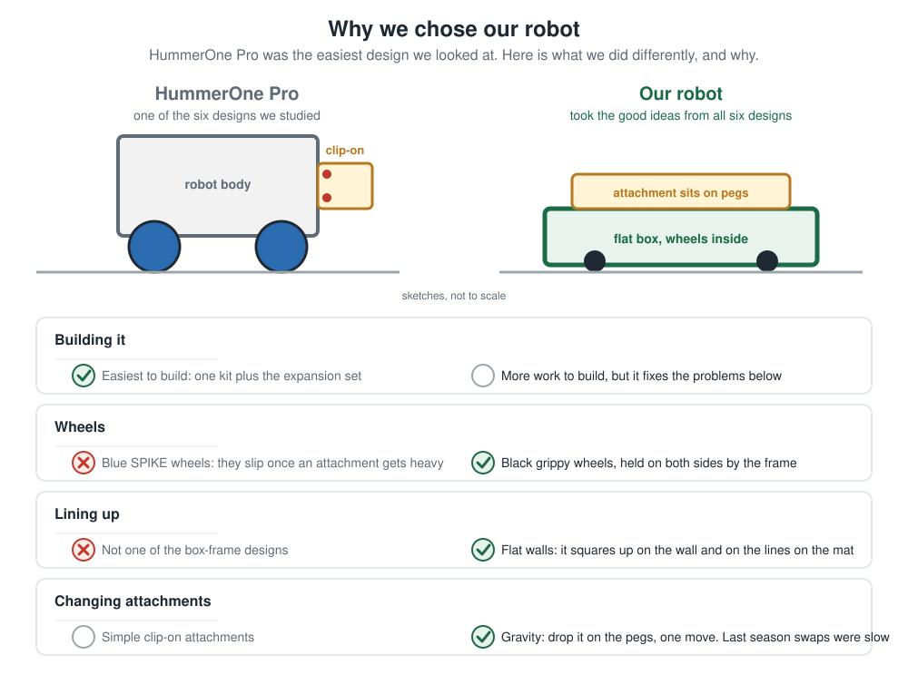{ loading=lazy }

    - **Flat:** lines up on the wall and the mat lines.
    - **6 ports:** 2 wheels, 2 attachments, 2 colour sensors.
    - **Push before motors.** A push can't go wrong.
    - **Gravity mounting** and a **stopper** for the arm.

-   **The code**

    ---

    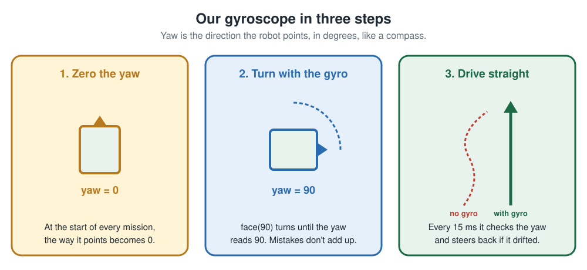{ loading=lazy }

    - **Python:** we reused last year's `drive_cm`.
    - **Only the gyroscope steers.**
    - **Yaw** = the way the robot points.
    - **Zero, turn, drive straight.**

</div>

??? note "All the key facts, in full sentences"
    **Mission strategy**

    - We do the missions closest to our home first. Short trips are quicker and
      more reliable.
    - We do several missions with the same attachment, so we stop to swap less
      often.
    - **The robo taxi:** the attachments and the keystone species wait on the
      left. phase3 does a mission on the way across the mat, M05 Reaching Roots,
      then carries one attachment and the keystone species to the right side. The
      keystone species goes on the Mine dock for M13. The rulebook gives M13 30
      points.
    - phase2 does M01 Drone Survey and M15 Biocentric Architecture with one
      straight push and back, so it is very reliable.
    - We skipped M04 Lucky Leaves: far away, partly luck, and only 10 or 20 points.

    **The robot**

    - A flat robot with straight walls. It lines up against the field wall and
      with the lines on the mat, so every run starts straight.
    - The hub has six ports: two for the wheel motors, two for the attachment
      motors, and two for colour sensors.
    - **Push and pull before motors.** Where we can, an attachment just pushes or
      pulls. A motor can go wrong; a push can't.
    - **Gravity mounting.** Pegs line the attachment up and its own weight holds
      it. Last season, changing attachments took a long time. Now it is one move.
    - **The stopper.** A motor arm always starts resting on its stopper, so it
      starts from the same fixed point every run.

    **The code**

    - **Python, to reuse code.** Last year's team left us Python. Our drive
      command, `drive_cm`, came from it. We only changed the wheel size, from
      88 mm to 62.4 mm. Python also gives us more control over every number.
    - **Only the gyroscope steers.** The two colour sensors are plugged in, but we
      don't use them, or any light sensor, to steer.
    - **Yaw** is the direction the robot is pointing, in degrees, like a compass.
    - **The gyroscope in three steps:** zero the yaw at the start of every mission
      program; turn with the gyroscope, so `face(90)` means 90 degrees from that
      start; and drive straight, checking the yaw every 15 milliseconds and
      steering back if it drifted.

## 1. The ten rubric lines

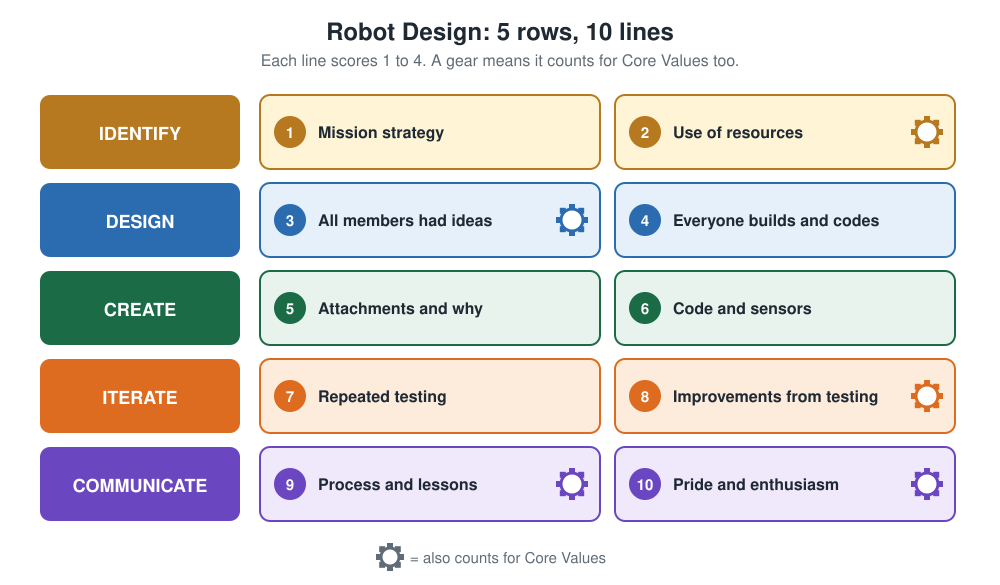{ loading=lazy }

- **Official:** each line scores Beginning 1, Developing 2, Accomplished 3 or
  Exceeds 4.
- **Official:** for Exceeds, the judge must write a short comment saying why.
- **Our advice:** so give them something to write: a **number**, a **true
  story**, or a **thing they can see**.

| # | Line | Official words for Accomplished (3) | Exceeds could look like |
| --- | --- | --- | --- |
| 1 | Mission strategy | "Clear evidence of mission strategy." | Everyone explains each mission with points, seconds and works out of 10 |
| 2 | Use of resources | "Clear use of building or coding resources to support their mission strategy." | We say what we took from each resource, and what we changed |
| 3 | All members' ideas | "Clear evidence that all team members contributed ideas." | Each member names their own idea on the robot |
| 4 | Building and coding skills | "Clear evidence of building and coding skills in all team members." | Every member shows one build and one piece of code |
| 5 | Attachments | "Clear explanation of innovative attachments and their purpose." | We show the old version and say why we changed it |
| 6 | Code and sensors | "Clear explanation of innovative code and/or sensor use." | We explain the gyro with our own numbers |
| 7 | Testing | "Clear evidence of repeated testing of their robot and code." | We give 10-run numbers without being asked |
| 8 | Improvements | "Clear evidence of improvements based on testing." | A number before, a change, a number after, and what failed |
| 9 | Process and lessons | "Detailed explanation of process and lessons learned." | Each member says a real lesson in their own words |
| 10 | Pride and enthusiasm | "Team clearly shows pride or enthusiasm for their work." | Everyone keen, sharing credit, calm on hard questions |

### Line 1: Mission strategy (IDENTIFY)

!!! tip "Say it to a judge"
    "We start on the left and finish the close missions first. Then the robo taxi
    carries our attachment and the keystone to the right. We skipped Lucky Leaves:
    far, partly luck, and only 10 or 20 points."

??? note "More: evidence, mistakes, how to improve"
    - **Evidence:** the [mission map](diagrams/mission-route.svg), a missions table
      with points, seconds and works out of 10, and skip reasons with numbers.
    - **From our test:** "only worth 10 points ... it would work 30% of the time so
      we figured it was not worth it."
    - **Mistakes:** "We did the easy ones." "It was too hard." Different members
      giving different mission lists.
    - **Improve:** agree one missions table. Time each run. Run each one 10 times.
    - **Judges ask:** Why these missions? Why that order? What would you add?

### Line 2: Use of resources (IDENTIFY, gear line)

!!! tip "Say it to a judge"
    "We compared six designs before building. The BOXOR frame is a published
    design, and we changed it: one arm became two, so one attachment does
    missions 1 and 2."

??? note "More: evidence, mistakes, how to improve"
    - **Evidence:** the [six designs comparison](chassis-designs-slides.html), the
      wheel pattern, last year's Python, and the BOXOR frame.
    - **Ours:** we kept last year's `drive_cm` and only changed the wheel size,
      88 mm to 62.4 mm.
    - **Mistakes:** "We looked online." Hiding that we used a design. The rubric
      says "improved on existing ones", so using one is fine.
    - **Improve:** for each resource, one line: what we took, and what we changed.
    - **Judges ask:** Where did your ideas come from? Did you design this yourselves?

### Line 3: Contributions of all team members (DESIGN, gear line)

!!! tip "Say it to a judge"
    "We disagreed about **[what]**. We tried both ideas, tested them, and picked
    **[which]** because **[result]**." Use a real disagreement.

??? note "More: evidence, mistakes, how to improve"
    - **Evidence:** the [who did what](../docs/who-did-what.md) record, dated
      notebook entries, and everyone speaking.
    - **From our test:** when there is an argument, the team votes.
    - **Mistakes:** one student answers everything. "We all did everything."
    - **Improve:** each member writes "an idea I had" on homework slide T10.
    - **Judges ask:** Whose idea was the robo taxi? Did you ever disagree?

### Line 4: Building and coding skills (DESIGN)

!!! tip "Say it to a judge"
    "I built **[part]**. I coded **[run]**. This line, `await face(0)`,
    straightens the robot after it hits the rock."

??? note "More: evidence, mistakes, how to improve"
    - **Evidence:** a build and a code example for each member, and git history.
    - **Mistakes:** builders who never coded, coders who never built. "I helped
      with stuff."
    - **Improve:** anyone missing one gets a small job: tune one `#was` number, or
      rebuild one arm.
    - **Judges ask:** Show me something you built. Explain one line you wrote.

### Line 5: Attachments and their purpose (CREATE)

!!! tip "Say it to a judge"
    "Gravity mounting is one move: lower it onto the pegs. Last season, clipping
    attachments on took a long time. When we pushed our arm into its stopper, the
    attachment lifted, so we stopped doing that."

??? note "More: evidence, mistakes, how to improve"
    - **Evidence:** the attachments on the table, before and after photos, a timed
      swap, and the [gravity mounting picture](diagrams/gravity-mount.svg).
    - **Ours:** the BOXOR bevel gears turn the movement through 90 degrees. Where
      we can, we push instead of using a motor.
    - **Mistakes:** saying what it does but not why. No old version to show.
    - **Improve:** time five swaps and use the middle one. Keep one old version.
    - **Judges ask:** Why gravity mounting? Has one fallen off? Why on the back?

### Line 6: Code and sensor use (CREATE)

!!! tip "Say it to a judge"
    "Every 15 milliseconds it reads the gyro. If we've drifted, it speeds up one
    wheel and slows the other, more the further off we are. If it gets 45 degrees
    off, it stops."

??? note "More: evidence, mistakes, how to improve"
    - **Evidence:** the [gyro loop](diagrams/gyro-loop.svg), the turn test numbers,
      and the safety stops.
    - **Ours:** `face` measures from the start, so a square ends 1 degree off, not
      17.
    - **Mistakes:** "We used the gyro." Big words like PID with no idea what they
      mean.
    - **Improve:** every coder practises the 5-degree example: drift 5 left, error
      -5, trim +94, so it steers back right.
    - **Judges ask:** How does it drive straight? Why not the colour sensor?

### Line 7: Testing (ITERATE)

!!! tip "Say it to a judge"
    "We run each program 10 times and write down how many work. phase2 is one
    straight push and back, which is why it is so reliable."

??? note "More: evidence, mistakes, how to improve"
    - **Evidence:** run logs with dates, counts out of 10, the 34 automatic code
      checks, and the printed arm logs.
    - **Mistakes:** "We tested it a lot." Not writing it down. Changing three
      things at once.
    - **Improve:** ten runs per program before judging. Use the tables in
      [section 4](#4-testing-and-iteration).
    - **Judges ask:** How do you know it's reliable?

### Line 8: Improvements (ITERATE, gear line)

!!! tip "Say it to a judge"
    "Our arm was sometimes too high. We printed the motor's position and found the
    start changed by 45 degrees. Two fixes failed. The third, starting on the
    stopper, works even after we re-seat the attachment."

??? note "More: evidence, mistakes, how to improve"
    - **Evidence:** `#was` notes in the code, the arm log table, and the design log.
    - **Mistakes:** only success stories. "We fixed it" with no number.
    - **Improve:** every member learns one fix story: problem, how we found out,
      what we changed, result with a number.
    - **Judges ask:** Show me something you changed. What didn't work?

### Line 9: Engineering process and lessons learned (COMMUNICATE, gear line)

!!! tip "Say it to a judge"
    "We learned to measure before we fix. With the arm we guessed twice and were
    wrong. The printed numbers showed the real cause."

??? note "More: evidence, mistakes, how to improve"
    - **Evidence:** the notebook, the design log, and the order of our five minutes.
    - **Mistakes:** lessons that are just events. Everyone saying the same lesson.
    - **Improve:** each member writes "we learned that ... because ...".
    - **Judges ask:** What would you do differently? What was hardest?

### Line 10: Team pride and enthusiasm (COMMUNICATE, gear line)

!!! tip "Say it to a judge (from our test)"
    "I am so proud that we were one time top of the table in our competition that
    had 32 teams."

??? note "More: mistakes, how to improve"
    - **Mistakes:** reading from cards. One member doing all the talking. A flat
      voice.
    - **Improve:** practise until it sounds like a conversation. Each member picks
      the thing they are proudest of.

## 2. Mechanical engineering

Eight ideas about how our robot is built. Each one has a picture, a few short
lines, and what to say to a judge. All of this is **our advice**.

<div class="grid cards" markdown>

-   **1. A flat box**

    Pushed against a wall, it can only sit square.

-   **2. Weight low**

    Heavy parts low and in the middle, so it doesn't rock.

-   **3. Grippy wheels**

    The designs that slipped all had blue wheels.

-   **4. Gears**

    Count the teeth. Slower and stronger, or faster and weaker.

-   **5. One base**

    Get the base right once. Then only attachments change.

-   **6. Clever, not complicated**

    The robo taxi, gravity mounting, and pushing instead of a motor.

-   **7. Same every time**

    Same start, same stopper, same pegs.

-   **8. Say why**

    "We chose ... because ... We tested ... and got ..."

</div>

### Driving base

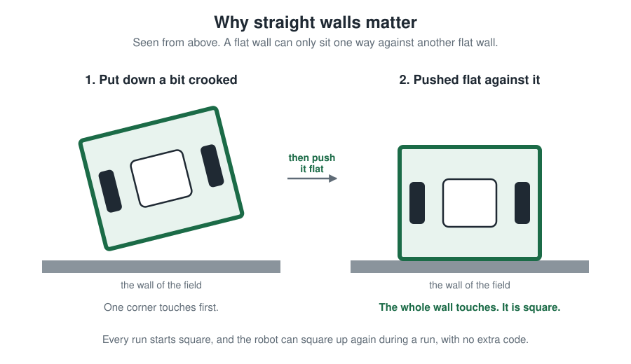{ loading=lazy }

- Our robot is a **flat box** with straight walls.
- Push it back against the wall, and it can only sit **square**.
- The wheels sit **inside the frame**, held on both sides.

!!! tip "Say it to a judge"
    "Our robot is a flat box. Push it against the wall and it sits square, so
    every run starts the same way. It lines up with the lines on the mat too."

### Stability and weight distribution

{ loading=lazy }

- Heavy parts go **low** and in the **middle**.
- Our hub lies flat, face up.
- **Try it:** stop hard from full speed. Does it wobble? Write down where the
  heaviest part is.

!!! tip "Say it to a judge"
    "We kept the heavy parts low, so the robot stops flat instead of rocking."

### Wheel configuration

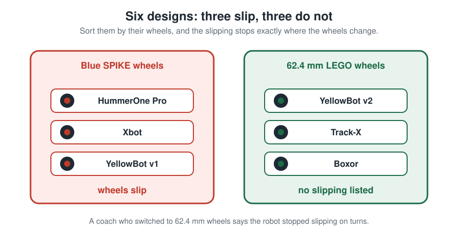{ loading=lazy }

- The three designs that **slipped** all had blue SPIKE wheels.
- So we use grippy wheels. Our code expects them to be **62.4 mm** across.
- **Try it:** measure our wheels with a ruler. Check `WHEEL_D_MM = 62.4` in
  `code/library/advanced.py`.

!!! tip "Say it to a judge"
    "We compared six designs. The ones that slipped all had blue wheels, so we
    chose grippy ones."

### Gear ratios and mechanical advantage

{ loading=lazy }

- **Count the teeth** on both gears.
- **Gear ratio = teeth on the second gear / teeth on the first.**
- Small gear turns a big one: **slower, but stronger**. Good for lifting.
- Big gear turns a small one: **faster, but weaker**. Good for a quick flick.

**To do:** count the teeth on the BOXOR frame's bevel gears. If both have the
same number, the ratio is 1, and the gears just turn the movement round a
corner.

**Gear play** is the little wobble between teeth.

{ loading=lazy }

- Our Phase 7 arm showed it. The motor stopped in the same place every run, but
  the arm ended a little higher or lower.
- **Fix 1:** a rubber band pulls the arm one way, so the gap is always on the
  same side.
- **Fix 2:** a worm gear can't be pushed backwards, so it doesn't wobble.

!!! tip "Say it to a judge"
    "Our bevel gears have __ and __ teeth, so the ratio is __. We found a little
    play in the arm by printing the motor's position, and we're fixing it with
    a rubber band."

### Modular, quick and multi-purpose attachments

{ loading=lazy }

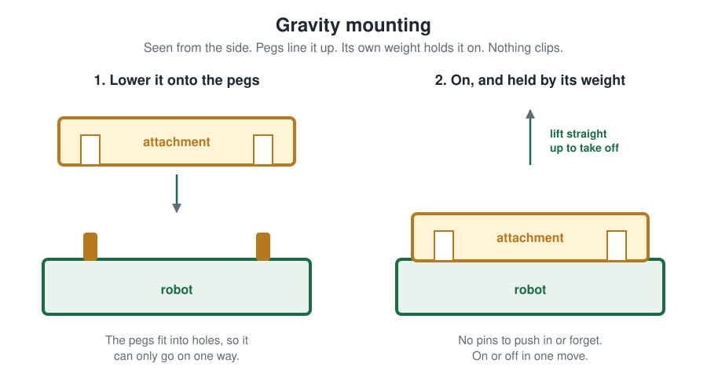{ loading=lazy }

- **One base, many attachments.** Every change to the base breaks the
  attachments, so freeze the base first.
- **Gravity mounting:** drop the attachment on the pegs, one move. Last season,
  swaps were slow.
- **One attachment, several missions**, so we swap less.

!!! tip "Say it to a judge"
    "Our attachments drop onto pegs and their weight holds them, so a swap is
    one move. It takes __ seconds."

### Innovative mechanisms

{ loading=lazy }

- **Innovative** means a clever answer to *our* problem, not a complicated
  machine.
- Our three: the **robo taxi**, **gravity mounting**, and a **push instead of a
  motor**.
- A push can't go wrong the way a motor can.

!!! tip "Say it to a judge"
    "Our cleverest idea is the robo taxi. One trip carries the attachment and the
    keystone species to the right, so the robot doesn't come back for them."

### Repeatability, reliability and alignment

Do this before every run:

| | Check |
| --- | --- |
| ☐ | Robot square against the **same wall**, in the **same spot** |
| ☐ | Motor arm resting on its **stopper** |
| ☐ | Attachment pressed down on its **pegs** |
| ☐ | A **push** instead of a motor wherever it works |

!!! tip "Say it to a judge"
    "Every run starts the same way: square on the wall, arm on the stopper. That's
    why it does the same thing every time."

### How to justify a design choice

Use this sentence for any choice:

!!! example "The sentence"
    "We chose **___** because **___**. We tested **___**, and the result was
    **___**."

**Example:** "We chose **gravity mounting** because **last season, swaps took a
long time**. We **timed a swap**, and it takes **__ seconds**." Fill in the real
time.

## 3. Programming

All of this is **our advice**, with our real code as the example.

!!! tip "Try it on the pretend robot"
    Every idea here runs on the [simulator quiz](../code/learn/15-code-quiz.md),
    with our real library.

### How our code is organised

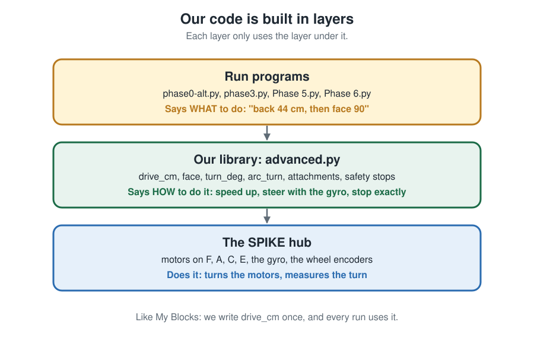{ loading=lazy }

- **Run programs** say *what* to do: `drive_cm(-44)`, `face(90)`.
- **Our library**, `advanced.py`, says *how*: ramps, gyro steering, safety stops.
- `tools/build-mission.py` copies the library into each run file, so the copies
  can't drift apart.

### Gyro navigation and heading correction

{ loading=lazy }

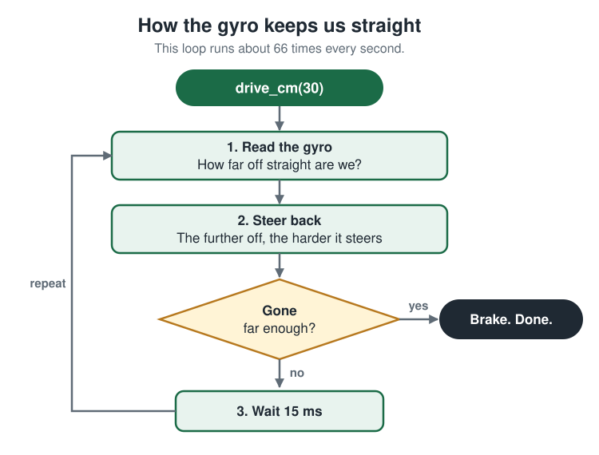{ loading=lazy }

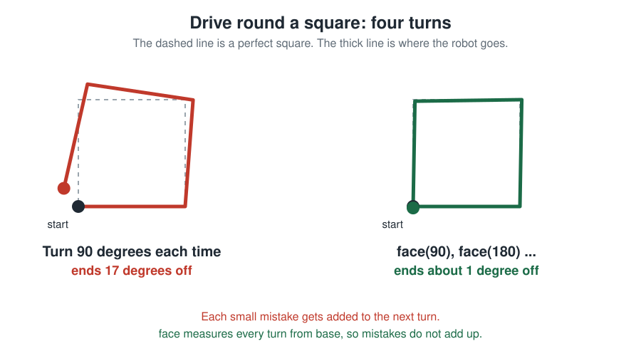{ loading=lazy }

??? example "The code, step by step (pseudocode)"
    Driving straight, simplified from `drive_cm`:

    ```
    start: work out how many wheel degrees the distance needs
    repeat every 15 ms:
        error = how far off straight the gyro says we are
        if error is more than 45 degrees: brake and stop with an error
        trim  = -(18.9 x error + 5.25 x (error - last error))
        left wheel  = speed + trim
        right wheel = speed - trim
    until the wheels have turned far enough
    brake a little early, because the robot rolls on
    ```

    Turning, simplified from `face`:

    ```
    target = the direction we want, measured from base
    repeat every 15 ms:
        error = target - where we point now
        if error is under 1 degree: brake
        speed = 7.35 x error + 0.0105 x (error added up) + 1.05 x (change in error)
        never slower than 126, or the wheels only buzz
    after braking, wait 0.15 s and check again, up to two more times
    ```

### PID, in plain words

| Part | In plain words | Used by |
| --- | --- | --- |
| **P**, proportional | Far from the target, push hard. Close, push gently. | `drive_cm` and `face` |
| **I**, integral | Stuck a little short for a while? Push a little more. | `face` |
| **D**, derivative | Closing in fast? Ease off, so it doesn't swing past. | `drive_cm` and `face` |

### Colour sensors, distance sensors and line following

- **Two colour sensors are plugged in, but only the gyroscope steers.** We stopped
  using the colour sensors on 20 September.
- Our code doesn't use a distance sensor.
- A colour sensor helps most to stop exactly on a line. Our flat robot lines up
  on the lines anyway.

??? example "Line following, as an idea (pseudocode)"
    ```
    repeat:
        reading = colour sensor reflection, 0 to 100
        error = reading - 50          (50 = half on the line, half off)
        steer by 0.5 x error
    until we have gone far enough, or a timeout
    ```

    The timeout matters. Our old Word Blocks waited for a line forever: one missed
    line and the robot sat still for the rest of the match.

### Sensor-based positioning and calibration

| What | How we fixed it |
| --- | --- |
| Direction and distance | Back gently into a wall to square up |
| Distances a little short | Asked for 180 cm, got 179, so `set_calibration_scale(179/180)` |
| Which way the gyro counts | `YAW_SIGN = -1`, measured on 20 September |
| Where the arm starts | Phase 7 makes the arm's stopper its zero |

### Error recovery

| What goes wrong | What our code does |
| --- | --- |
| A distance longer than the 200 cm mat | Refuses: it's millimetres typed by mistake |
| A straight drive more than 45 degrees off | Brakes and stops with an error |
| A turn getting further from its target | Brakes and stops with an error |
| A drive or turn taking over 8 seconds | Gives up and goes on |
| An attachment move blocked | `run_for_degrees` reports `motor.STALLED`, and Phase 7 prints it |

### Consistent mission execution

| | Every run |
| --- | --- |
| ☐ | The same start, squared on the wall |
| ☐ | `face` measures from the start, so errors don't add up |
| ☐ | Short runs and simple pushes, like phase2 |
| ☐ | One change at a time, then test again |

## 4. Testing and iteration

### The method

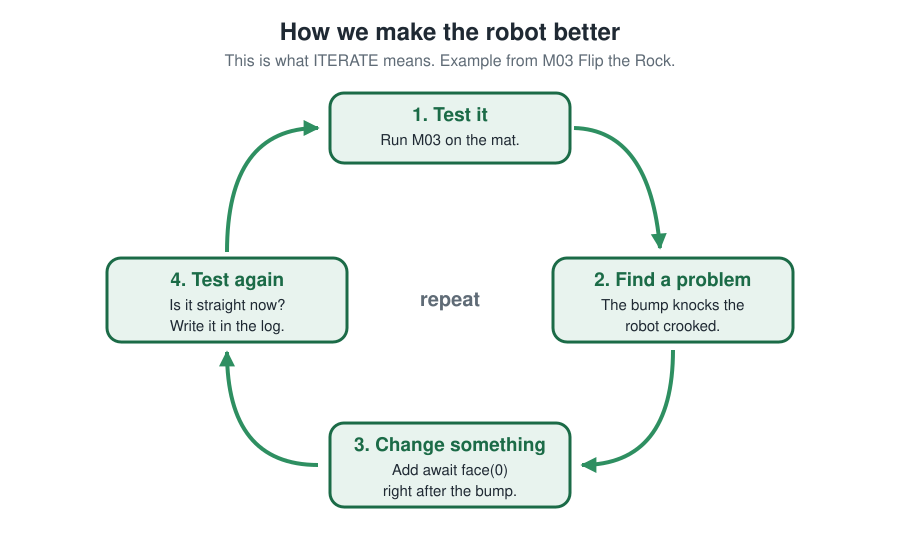{ loading=lazy }

1. Decide what you are measuring.
2. Change **one** thing only.
3. Run it **10 times**, set up the same way.
4. Write **every** result down, even the failures.
5. Compare with before.

### Mission success rates

Run each program 10 times and fill in this table.

| Run | Missions | Tries | Worked | Date |
| --- | --- | --- | --- | --- |
| phase0-alt | M03, M02 | 10 | __ | __ |
| phase2 | M01, M15 | 10 | __ | __ |
| phase3 | M05, robo taxi | 10 | __ | __ |
| Phase 5 | M06, M07, M11, M12 | 10 | __ | __ |
| Phase 6 | M13 | 10 | __ | __ |

### Heading accuracy

**Our data,** from our turn test:

| Turn method | Time | How far off |
| --- | --- | --- |
| Old turn, counting wheel degrees | 1.54 s | 4.26 degrees |
| **Gyro turn** | **1.18 s** | **0.58 degrees** |

### Distance accuracy

**Our data:** `drive_cm(180)` drove 179 cm, which gave the 179/180 calibration.

??? example "A repeat test, example only"
    | Asked for | Run 1 | Run 2 | Run 3 | Run 4 | Run 5 | Average |
    | --- | --- | --- | --- | --- | --- | --- |
    | 30 cm | 30.1 | 29.8 | 30.0 | 30.2 | 29.9 | 30.0 |

### Attachment reliability

**Our data,** Phase 7 arm, first move, 21 November:

| What we tried | Runs | Arm right? |
| --- | --- | --- |
| Zero wherever the arm was | 2 | 1 of 2. Starts were 45 degrees apart |
| Zero from the motor's angle | 6 | 5 of 6, then wrong after re-seating |
| Push into the stopper | 1 | No: it lifted the attachment |
| **The stopper is zero** | **4** | **Works after re-seating.** A little play left |

### Failure analysis

**Our data,** from git history and our notes:

| Date | What went wrong | What we changed | Result |
| --- | --- | --- | --- |
| 13 to 20 Sep | Wrong motor ports | Tested each port | Wheels on F and A |
| 20 Sep | `drive_cm(-44)` spun on the spot | `YAW_SIGN = -1` | Drives straight |
| 26 Sep | Some turns spun for 30 seconds | `_wrap180` | Turns stop on target |
| __ | Crooked after the rock | `face(0)` after the bump | Drives on straight |
| 21 Nov | Phase 7 arm height changed | Stopper is zero | Consistent after re-seating |

### Proving a change came from evidence

| 1. A number before | 2. One change, and why | 3. A number after |
| --- | --- | --- |
| "4 out of 10" | "We added `face(0)` because the bump knocked it crooked" | "9 out of 10" |

Keep the old number, even when it's embarrassing. It is the evidence.

### Design improvement record

Copy this into the design log for every change.

| Date | Who | Problem | Evidence | Change | Result | Next |
| --- | --- | --- | --- | --- | --- | --- |
| | | | | | | |

## 5. The engineering notebook

Write in it **during** the season, not at the end. Date every entry, and say who
wrote it. The rules are on the [Engineering Notebook page](../engineering-notebook/README.md).

| Section | What to put in it | Sample entry |
| --- | --- | --- |
| 1. Initial ideas | First thoughts | "Robot should be low so it can't tip." |
| 2. Mission strategy | Table, map, what we skip | "Skip M04: far, part luck, 10 or 20 points." |
| 3. Robot architecture | Base, hub, ports, wheels | "Wheels F and A. Attachments C and E." |
| 4. Alternative designs | Designs we compared | "HummerOne Pro: easy, but blue wheels slip." |
| 5. Mechanical sketches | Drawings with measurements | The BOXOR frame, gear teeth counted |
| 6. Attachment development | Each version, with a photo | "Mission 2: circle got stuck, so we changed it." |
| 7. Programming decisions | Why Python, key commands | "Kept last year's drive_cm, new wheel size." |
| 8. Sensor experiments | What we tried, and the result | "Gyro turn 0.58 degrees off, wheel turn 4.26." |
| 9. Testing logs | Run tables, counts | "phase2: __ out of 10, 22 Nov." |
| 10. Failures and solutions | The failure table | "26 Sep: turns spun. Fixed with _wrap180." |
| 11. Design iterations | Versions 1, 2, 3, with photos | "Arm: 3 ways to set zero, the third works." |
| 12. Individual contributions | Who built, coded, suggested | Copy of [who did what](../docs/who-did-what.md) |
| 13. Final design decisions | What we froze, and why | "Froze the base on __." |

??? example "A full sample entry"
    > **21 November, Testing lead.** Problem: the Phase 7 arm is sometimes too
    > high. Evidence: we printed the motor position. Two runs started 45 degrees
    > apart. Change: the stopper is the arm's zero. Result: 2 good runs after
    > re-seating, 1 a little high, 1 too low. The motor did the same each time, so
    > the rest is play in the gears. Next: try a rubber band.

## 6. The five-minute explanation

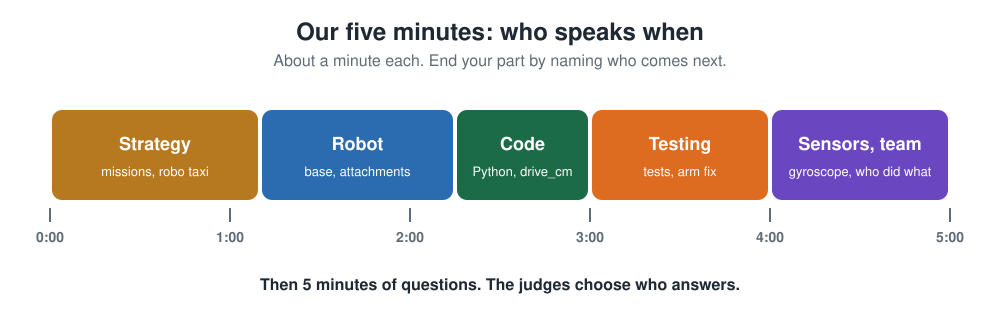{ loading=lazy }

- **Official:** 5 minutes to explain, then 5 minutes of questions. Plan to talk
  "without the robot game field."
- **Our advice:** know the points, not the exact words. End your part by naming
  who comes next.

### Strategy lead: intro and mission strategy (0:00 to 1:10)

- Time is our biggest limit. Close missions first.
- phase2: one straight push and back.
- The robo taxi carries the attachment and the keystone to the right.
- We skipped Lucky Leaves, with the reason.

**Show:** point at the [mission map](diagrams/mission-route.svg).

??? quote "The full starter script"
    "Hello, we're the Bumble Bots. In the Robot Game we have two and a half
    minutes, so our biggest limit is time. Almost every choice we made was to save
    time.

    First, we do the missions close to our home first. Short trips are quicker and
    more reliable. Our first runs do Flip the Rock and Exploding Seeds, then the
    Drone Survey and Biocentric Architecture. That run is one straight push and
    back, so it hardly ever goes wrong.

    Then comes what we call the robo taxi. Our attachments and the keystone species
    wait on the left. The robot does Reaching Roots on the way, then carries one
    attachment and the keystone species across to the right. That one attachment
    does several missions there, so we don't stop to swap.

    We skipped Lucky Leaves. It's far away, partly luck, and only 10 or 20 points.
    Now [Robot lead] will show you the robot."

### Robot lead: the robot and attachments (1:10 to 2:15)

- We compared six designs. Blue wheels slip, so ours grip.
- Flat, so it lines up on the wall and the mat lines.
- Gravity mounting: one move. Push before motors. The arm starts on a stopper.

**Show:** a live swap, and an old attachment next to the new one.

??? quote "The full starter script"
    "Before we built anything, we compared six robot designs. The three that
    slipped all had blue SPIKE wheels, so we chose grippy wheels.

    Our robot is flat, with straight walls. It lines up against the wall and with
    the lines on the mat, so every run starts straight. The hub has six ports: two
    for the wheels, two for the attachment motors and two for colour sensors.

    To change attachments fast we use gravity. Pegs line the attachment up, and
    its own weight holds it. Last season, changing attachments took a long time.
    Now it's one move." *(Do a live swap.)*

    "Where we can, we use simple push and pull attachments instead of a motor. A
    motor can go wrong, but a push can't. When we do use a motor arm, it always
    starts on a stopper, so it starts from the same fixed point every time. Next,
    [Code lead] will explain our code."

### Code lead: programming (2:15 to 3:00)

- Python, so we reused last year's `drive_cm`. We changed the wheel size.
- Code in layers: the run says what, the library says how.
- The safety stop at 45 degrees.

**Show:** one function on paper, and the [code layers](diagrams/code-layers.svg).

??? quote "The full starter script"
    "We code in Python. Last year's team left us Python, so we could reuse it. Our
    drive command, drive_cm, is from last year. We only changed the wheel size.
    Python also gives us more control over every number.

    Our code is in layers. Each run says what to do, like drive 44 centimetres and
    face 90. Our library says how: speed up gently, steer, and stop on the mark. If
    the robot ever gets 45 degrees off course, it stops instead of spinning off the
    table. Now [Testing lead] will tell you how we test."

### Testing lead: testing and a fix story (3:00 to 4:00)

- We test each run 10 times. Say a real number.
- The arm fix: measured, two fixes failed, the stopper works.
- Lesson: measure first, then fix.

**Show:** the printed run log table.

??? quote "The full starter script"
    "We test each run ten times and write down how many work." *(Say a real
    number.)* "Here's one fix. The arm in one run was sometimes too high and
    sometimes too low. We printed where the motor was after every move. That
    showed the arm wasn't starting in the same place: two runs started 45 degrees
    apart.

    Our first idea worked until we took the attachment off and put it back. Our
    second idea, pushing the arm into its stopper, lifted the attachment off. So we
    used the simplest answer: the arm starts on its stopper every time, and the
    code counts from there. Now it works even after we put the attachment back on.
    We learned to measure first, then fix. Now [Sensors and team lead] will tell
    you about our sensors and our team."

### Sensors and team lead: sensors, then team and lessons (4:00 to 5:00)

- Only the gyroscope steers. The colour sensors are plugged in, not used.
- Yaw, and the three steps: zero, turn, drive straight.
- Then the team: all five of us built and coded. Each says one line.
- What we're proudest of. "Ask any of us anything."

**Show:** the [gyro steps](diagrams/gyro-steps.svg), then the who-did-what page.

??? quote "The full starter script"
    "We only use the gyroscope to steer. Our two colour sensors are plugged in, but
    we don't use them. The gyroscope measures yaw: the way the robot points, like
    a compass. We use it in three steps. Zero the yaw at the start, turn with the
    gyroscope, and check the yaw every 15 milliseconds to drive straight.

    All five of us built something and coded something." *(Each member says one
    sentence: "I built ... and I coded ...")* "We're most proud of ... Thank you.
    Ask any of us anything."

## 7. Judge questions

<div class="grid cards" markdown>

-   **Short**

    Two or three sentences, then stop.

-   **Honest**

    "I don't know, but my teammate built that" is a good answer.

-   **Your words**

    Know the idea. A learned answer falls apart at the follow-up.

</div>

??? question "Mechanical engineering: 10 questions"
    1. **Why is your robot shaped like that?** "A flat box squares up on a wall, so
       every run starts the same way." *Follow-up: what if it starts crooked?*
    2. **Why those wheels?** "The designs that slipped all used blue SPIKE wheels,
       so we use grippy ones." *Follow-up: how did you check yours don't slip?*
    3. **Where is the robot's weight?** Team to measure: say where the heaviest
       part is, and that you checked for a wobble. *Follow-up: how did you test it?*
    4. **How does the BOXOR frame move the arm?** "Two bevel gears turn the
       movement through 90 degrees." *Follow-up: what is the gear ratio?*
    5. **Why gravity mounting?** "One move to swap. Last season, swaps were slow."
       *Follow-up: has one ever fallen off?*
    6. **How long does a swap take?** Give the measured time. *Follow-up: how did
       you measure it?*
    7. **Why a push instead of a motor?** "Motors can go wrong. A push can't."
       *Follow-up: when did you need a motor anyway?*
    8. **Why is the attachment on the back?** Team to agree. *Follow-up: why do
       your distances have minus signs?*
    9. **What would you change with more time?** "Take the play out of the arm
       gears, maybe with a rubber band." *Follow-up: how would you know it worked?*
    10. **What is the robo taxi?** "One trip carries the attachment and the
        keystone to the right." *Follow-up: what if the keystone falls off?*

??? question "Programming and sensors: 10 questions"
    11. **How does it drive straight?** "It reads the gyro every 15 ms and steers
        back, harder the further off." *Follow-up: what stops it wiggling?*
    12. **Why Python?** "Last year's Python, more control, and git shows every
        change." *Follow-up: what was hard about switching?*
    13. **What does `face(90)` do?** "Turns to point 90 degrees from where we
        started." *Follow-up: why not just turn 90?*
    14. **What is PID?** "P pushes harder when far off, I pushes more when stuck,
        D eases off when closing in fast." *Follow-up: which parts does drive_cm
        use?*
    15. **Why not the colour sensors?** "They're plugged in, but only the gyroscope
        steers. It works everywhere on the mat, not just near a line."
        *Follow-up: would a sensor have helped anywhere?*
    16. **What if something goes wrong in a run?** "More than 45 degrees off, it
        stops. Over 8 seconds, it gives up and goes on." *Follow-up: why stop?*
    17. **How are distances accurate?** "We asked for 180 cm and got 179, so we
        scale by 179/180." *Follow-up: what if you change the wheels?*
    18. **What did you reuse from last year?** "drive_cm. We changed the wheel size
        from 88 mm to 62.4 mm." *Follow-up: why did that number matter?*
    19. **How does the arm know where it is?** "It starts on its stopper, and the
        code calls that zero." *Follow-up: what if it doesn't start there?*
    20. **What's the cleverest thing in your code?** "The arm lifts while the robot
        drives home, by leaving out `await`." *Follow-up: how much time does it
        save?*

??? question "Strategy and testing: 7 questions"
    21. **Why this order of runs?** "Left first, close first, then the robo taxi."
        *Follow-up: what if the first run fails?*
    22. **Which mission did you skip?** "Lucky Leaves: far, partly luck, 10 or 20
        points." *Follow-up: what would make it worth doing?*
    23. **How reliable is your robot?** Give the 10-run numbers. *Follow-up: which
        run is weakest?*
    24. **How do you test a change?** "Change one thing, run it 10 times, compare."
        *Follow-up: give an example.*
    25. **What broke, and how did you fix it?** One fix story, four parts.
        *Follow-up: how did you find the cause?*
    26. **What didn't work?** "Pushing the arm into its stopper lifted the
        attachment, so we dropped that idea." *Follow-up: what did you do instead?*
    27. **How do you know a fix helped?** "A number before and a number after."
        *Follow-up: what if it only helped sometimes?*

??? question "Team: 5 questions"
    28. **Who built and coded what?** Each member answers for themselves.
        *Follow-up: explain your teammate's part.*
    29. **How did you share the work?** "Roles, and we swapped so everyone tried
        each." *Follow-up: what happened when you disagreed?*
    30. **Whose idea was the robo taxi?** The true answer. *Follow-up: how did the
        team decide?*
    31. **What did you learn?** One real lesson each. *Follow-up: how will you use
        it next season?*
    32. **What are you most proud of?** Said like you mean it. *Follow-up: why that
        one?*

## 8. Exceeds readiness scorecard

**Our advice.** The coach's estimate on 22 November 2026, from the
[Robot Design test](robot-design-test.md) answers. Not a judge's score. Nothing
is marked Exceeds yet, because we don't have the evidence yet.

| Line | Now | What's missing | Do this |
| --- | --- | --- | --- |
| 1. Mission strategy | Developing (2) | An agreed missions list, points and seconds | Agree the table. Time every run |
| 2. Use of resources | Developing (2) | Nobody mentioned the six designs or BOXOR | Everyone practises the six-designs story |
| 3. All members' ideas | Developing (2) | Two members gave no example | Fill "an idea I had" on T10 |
| 4. Building and coding | Developing (2) | Not every member has both | A small build or code job for each |
| 5. Attachments | Developing (2) | No swap time, no before photos | Time swaps. Photograph old versions |
| 6. Code and sensors | Accomplished (3), some members | Misses on sockets, YAW_SIGN, face | Re-teach those. Learn the 5-degree example |
| 7. Testing | Developing (2) | Only one member gave a number | Run every program 10 times |
| 8. Improvements | Developing (2) | No member could tell a fix story | Each member learns one. Print the arm log |
| 9. Process and lessons | Developing (2) | Most answered "I don't know" | Write "we learned that ... because ..." |
| 10. Pride and enthusiasm | Accomplished (3) | Two left the three sentences blank | Practise until it's a conversation |

--8<-- "includes/abbreviations.md"
