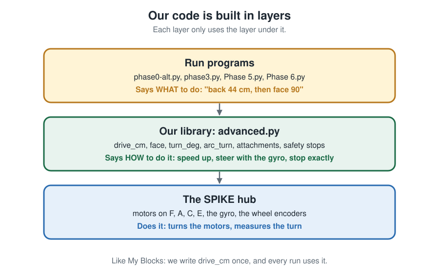
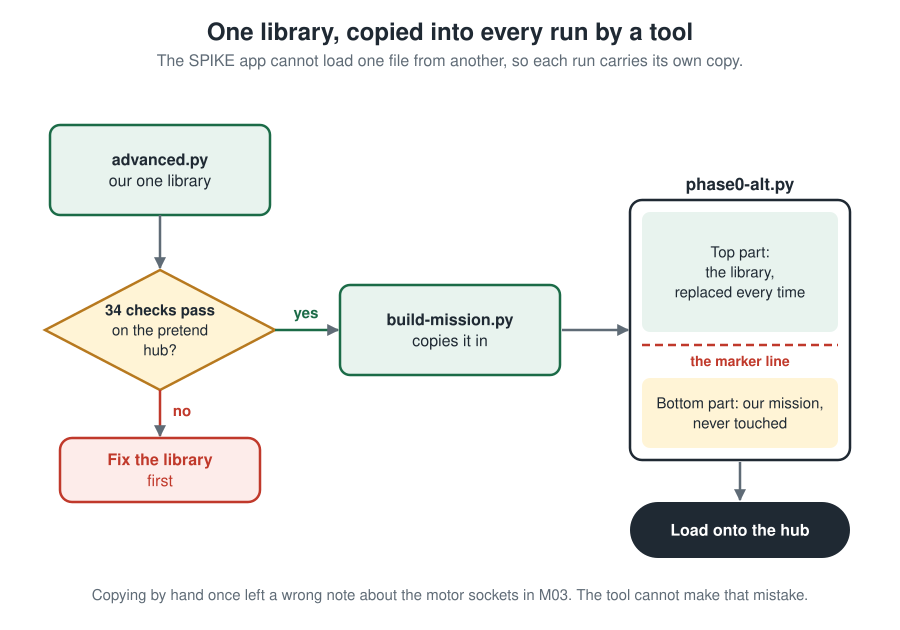
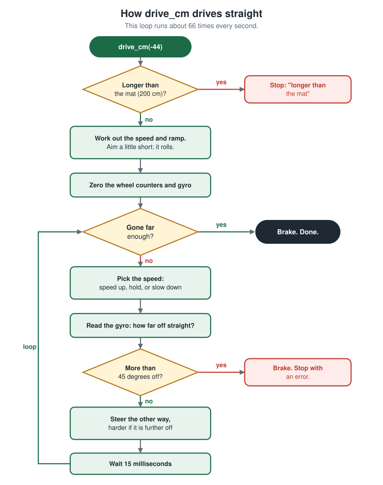
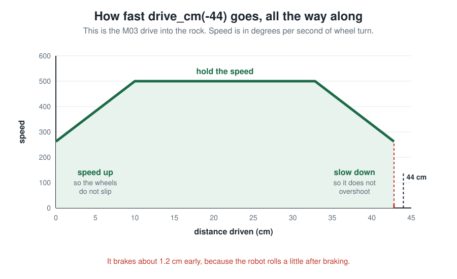
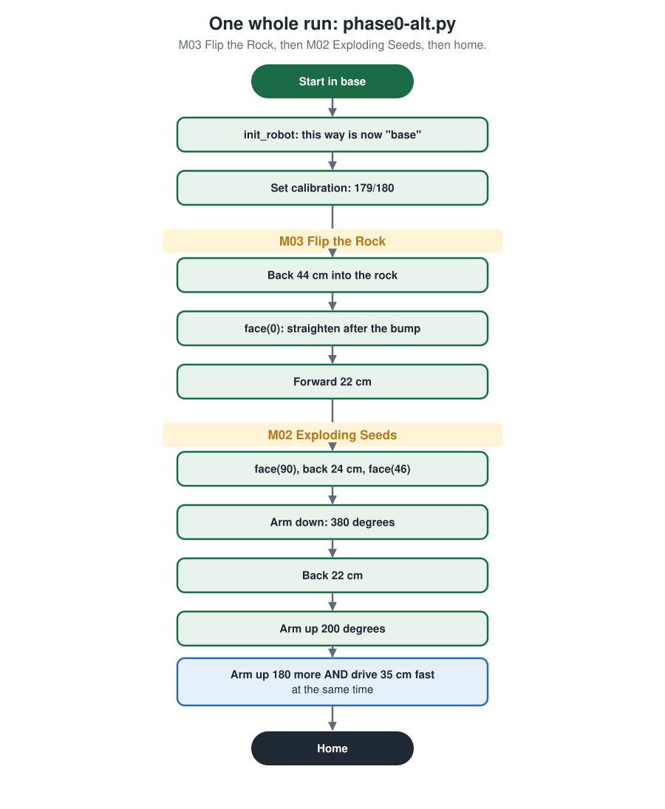
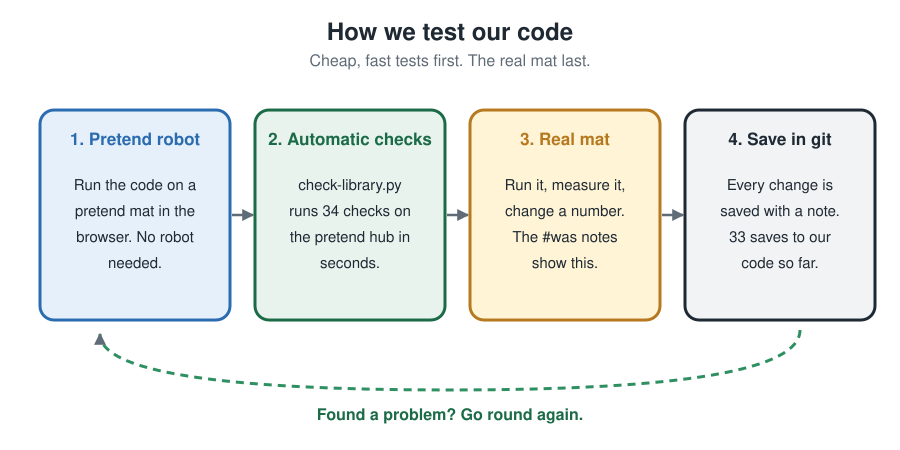

# How Our Code Is Designed

[Our Robot, Explained](our-robot-explained.md) says what our code does. This
page shows **how it is designed**, with flowcharts and diagrams from our real
code.

Judges look for this in the CREATE row: "Clear explanation of innovative code
and/or sensor use." Most teams can say "we used the gyro". Fewer can show
*how* their code uses it, and why it is built that way. This page helps you
do that.

**On this page:**

- [1. Our code is built in layers](#1-our-code-is-built-in-layers)
- [2. One library, copied in by a tool](#2-one-library-copied-in-by-a-tool)
- [3. How the robot drives straight](#3-how-the-robot-drives-straight)
- [4. How face turns exactly](#4-how-face-turns-exactly)
- [5. Doing two things at once](#5-doing-two-things-at-once)
- [6. A whole run as a flowchart](#6-a-whole-run-as-a-flowchart)
- [7. Safety stops](#7-safety-stops)
- [8. How we test our code](#8-how-we-test-our-code)
- [Words to know](#words-to-know)

Each section ends with a **Say it to a judge** box. It shows a weak answer and
a strong answer to the same question. Don't learn the strong answer by heart.
Learn *why* it is stronger, then say it in your own words.

## 1. Our code is built in layers

{ loading=lazy }

Our code has three layers, like floors in a building.

- **The run programs** are at the top. They say *what* to do, for example
  `await drive_cm(-44)` and then `await face(90)`.
- **Our library**, `advanced.py`, is in the middle. It says *how* to do it: how
  to speed up, how to steer with the gyro, and how to stop in the right place.
- **The SPIKE hub** is at the bottom. It turns the motors and reads the gyro.

A run program never has to think about steering. It just says
`drive_cm(-44)`, and the library does the hard part.

**Why this is good design.** We write the hard part once. When we make the
library better, every run gets better at the same time. For example, we fixed
the turns so they check again after braking. After that one fix, every turn
in every run was more accurate.

This is the same idea as My Blocks in Word Blocks: make a block once, then use
it everywhere.

!!! tip "Say it to a judge: How is your code organised?"
    **Weak:** "We have lots of programs."

    **Strong:** "Our code is in layers. The run programs only say what to do,
    like back 44 cm then face 90. Our library says how: it speeds up, steers
    with the gyro, and stops on the mark. When we improve the library, every
    run gets better at once."

## 2. One library, copied in by a tool

{ loading=lazy }

**The problem.** The SPIKE app runs one file at a time, and one file cannot
load another. So every run program needs its own copy of the library inside
it.

Copying by hand goes wrong. One mission file once had a note at the top saying
the drive motors were on "A (left), E (right)". The code below it used F and A.
Nobody noticed, because people copied the file around by hand.

**Our fix.** A small program, `tools/build-mission.py`, does the copying for
us. Each run file has a **marker line** in the middle:

```python
# ===== MISSION CODE BELOW. THE GENERATOR DOES NOT TOUCH THIS =====
```

Everything above the line is the library. The tool replaces it with a fresh
copy each time. Everything below the line is our mission, and the tool never
touches it.

`phase0.py`, `phase0-alt.py`, `phase1.py` and `phase2.py` have the marker
line. `phase3.py`, `Phase 5.py` and `Phase 6.py` have a copy of the library,
but no marker line.

!!! question "Team to answer"
    - How did `phase3.py`, `Phase 5.py` and `Phase 6.py` get their copy of the
      library?
    - Who runs `build-mission.py`, and when?

!!! tip "Say it to a judge: How do you get the code onto the robot?"
    **Weak:** "We copy it in."

    **Strong:** "The SPIKE app can't load one file from another, so each run
    needs its own copy of our library. Copying by hand once gave us the wrong
    motor ports in a file. So we use a small tool that copies the library in
    for us, and never touches the mission part."

## 3. How the robot drives straight

{ loading=lazy }

**Steering with the gyro.** Think about riding a bike. If you start to drift
left, you steer a little right. If you drift a lot, you steer more. `drive_cm`
does the same thing, about 66 times every second.

Here are the two lines that do it:

```python
error = _wrap180(_yaw_cw())
trim = -(kp * error + kd * (error - last_error))
```

- `error` is how far the robot is off straight, in degrees.
- `kp * error` steers back. The further off it is, the harder it steers.
- `kd * (error - last_error)` looks at how fast the error is changing. It
  calms the steering down, so the robot does not wiggle from side to side.
- The minus sign at the front makes it steer *against* the mistake. A comment
  in our code says that without it, "the robot spirals instead of driving".

**Speeding up and slowing down.**

{ loading=lazy }

If the robot starts at full speed, the wheels slip. If it stops from full
speed, it skids past the mark. So `drive_cm` speeds up gently, holds its
speed, and slows down gently. This is called a **ramp**.

The robot still rolls a little after the brakes go on. So `drive_cm` brakes a
little early, about 1.2 cm early on this drive, and the roll carries it onto
the mark.

!!! tip "Say it to a judge: How do you make it drive straight?"
    **Weak:** "We use the gyro."

    **Strong:** "About 66 times a second, our drive command reads the gyro to
    see how far off straight it is, and steers the other way. The further off,
    the harder it steers. It also speeds up and slows down gently, so the wheels
    don't slip and it doesn't overshoot."

## 4. How face turns exactly

{ loading=lazy }

`face(90)` turns until the robot points 90 degrees from base. It works out the
turning speed in three parts. Grown-ups call this **PID**:

| Part | Name | What it does |
| --- | --- | --- |
| P | Proportional | Far from the target: turn fast. Close: turn slowly. |
| I | Integral | Stuck a little short for a while? Push a little more. |
| D | Derivative | Closing in fast? Ease off, so it does not swing past. |

Two more details make it accurate:

- **A minimum speed.** Below 126, the wheels just buzz and don't move. So the
  turn always pushes at least that hard.
- **Check again after braking.** On our hub, the robot rolls about 2.4 degrees
  after the brakes go on. So `face` waits 0.15 seconds, looks at the gyro again,
  and fixes the roll. It can do this up to two more times.

!!! tip "Say it to a judge: How do you get consistent turns?"
    **Weak:** "We turn 90 degrees."

    **Strong:** "Our turns use the gyro and measure every direction from where
    the robot started, so mistakes don't add up. The turn slows down as it gets
    close, and after braking it checks the gyro again, because our robot rolls
    about 2 degrees past."

## 5. Doing two things at once

In our code, most lines start with `await`. `await` means "wait until this is
finished before going on". If you leave it out, the robot starts that action
and goes straight on to the next line, while the first one is still moving.

This is the end of `phase0-alt.py`:

```python
await motor.run_for_degrees(attachment2, 200, 1000)   # lift the arm, and wait
motor.run_for_degrees(attachment2, 180, 1100)         # start lifting more, don't wait
await drive_cm(35, velocity=1100)                     # drive home while the arm moves
```

The arm finishes lifting *while* the robot drives home. `phase3.py` does the
same thing: its comment says to bring the attachment up while driving back. A match is only 2 minutes 30 seconds, so every second saved counts.

!!! question "Team to answer"
    - How much time does this save? Time the run with and without `await`.
    - Who came up with this idea?

!!! tip "Say it to a judge: What is clever about your code?"
    **Weak:** "It works."

    **Strong:** "Our robot can do two things at once. At the end of the
    M02 run, the arm lifts while the robot is already driving home. We did
    that by leaving out `await` on the arm command, and it saves time in a
    two and a half minute match."

## 6. A whole run as a flowchart

{ loading=lazy }

A flowchart lets a judge see a whole run without reading any code. Draw it
before you write the code, and the code is easier to write.
[Lesson 13](../code/learn/13-flowcharts-judges.md) teaches how.

!!! question "Team to answer"
    Draw the flowchart for `Phase 6.py`, the Keystone Species run. It is the
    shortest one. Here is its code:

    ```python
    await drive_cm (-75, 1100)
    await face (44)
    await motor.run_for_degrees(port.E,-220,1100)
    await face (0)
    await drive_cm (75,1100)
    ```

## 7. Safety stops

A robot that goes wrong in a match can knock over models and lose points. So
our library watches for trouble and stops early.

| What goes wrong | What the code does | Why we added it |
| --- | --- | --- |
| A distance longer than the mat (200 cm) | Refuses, and says ".Forward 300 is drive_cm(30)" | Word Blocks use millimetres. Copying `300` across would ask for 3 metres. |
| A straight drive gets more than 45 degrees off course | Brakes, and stops with an error | On 20 September a wrong setting made the robot spin on the spot, and it spun right off the table. Now it stops first. |
| A turn gets further from its target, not closer | Brakes, and stops with an error | It is turning the wrong way. |
| A drive or turn takes more than 8 seconds | Gives up and goes on | The robot is stuck against something. Waiting wastes match time. |

!!! tip "Say it to a judge: What happens if something goes wrong?"
    **Weak:** "We try again."

    **Strong:** "Our code watches for trouble. If the robot gets more than 45
    degrees off course, it stops, instead of spinning off the table. We added
    that after it really spun off the table in testing, on 20 September."

## 8. How we test our code

{ loading=lazy }

We test the cheap, fast way first, and use the real robot last:

1. **Pretend robot.** The [lessons](../code/learn/14-simulated-missions.md) run
   our code on a pretend mat in the browser. No robot is needed.
2. **Automatic checks.** `tools/check-library.py` runs 34 checks on a pretend
   hub, in a few seconds. Some of them check that "a wrong YAW_SIGN stops
   instead of spinning" and that "millimetres typed into a centimetres argument
   is refused".
3. **The real mat.** Run it, measure it, and change a number. Every `#was` note
   in our code is one of these changes.
4. **Save in git.** Every change is saved with a note saying what changed and
   why. Our code has 33 saves so far.

!!! tip "Say it to a judge: How do you know your code works?"
    **Weak:** "We tried it."

    **Strong:** "We test in steps. First on a pretend robot in the browser,
    then with 34 automatic checks, then on the real mat. Every change is saved
    in git with a note, so we can see what we changed and go back if it gets
    worse."

## Words to know

**await.** "Wait until this is finished before going on."

**Error.** In our code, how far the robot is from where it should be.

**Library.** Code we write once and use in every run.

**Loop.** Code that repeats, again and again, until something is true.

**Marker line.** The line in a run file that separates the library from the
mission.

**PID.** A way of working out how hard to turn, from how far off we are (P),
how long we have been off (I), and how fast that is changing (D).

**Ramp.** Speeding up and slowing down gently.

**Timeout.** Giving up after a set time, so the robot never gets stuck forever.

## Next

Now take the [Robot Design test](robot-design-test.md).

--8<-- "includes/abbreviations.md"
