# Our Robot, Explained

This page is about **our** robot: how we built it, how the code works, and why
we made the choices we made. Read it all before you take the
[Robot Design test](robot-design-test.md). The judges can ask any of us about
any part of the robot, not just the part we worked on.

**On this page:**

- [How judges score Robot Design](#how-judges-score-robot-design)
- [How we chose our design](#how-we-chose-our-design)
- [1. The driving base](#1-the-driving-base)
- [2. Attachments](#2-attachments)
- [3. The code](#3-the-code)
- [4. Mission strategy and the runs](#4-mission-strategy-and-the-runs)
- [5. Testing and changing things](#5-testing-and-changing-things)
- [6. Words to know](#6-words-to-know)

You will see boxes like this one:

!!! question "Team to answer"
    These are questions only our team can answer. The answer is in your head,
    not on this page. Bring your answer to the brainstorm.

Important: if you don't know an answer, don't make one up. In the judging room,
"I don't know, my teammate built that part" is a fine answer. A made-up answer
falls apart as soon as the judge asks one more question.

## How judges score Robot Design

The judges use a score sheet called a **rubric**. It has five parts, and each
part has two lines. The judges give 1 to 4 points on every line. To get
**3 points (Accomplished)**, we need to show the things in the right-hand
column.

The words in the middle and right columns are copied exactly from the official
rubric, so you will recognise them on the day.

| Row | In plain words | Official words for 3 points |
| --- | --- | --- |
| **IDENTIFY** | We chose our missions on purpose, and we looked for help and ideas. | Clear evidence of mission strategy. Clear use of building or coding resources to support their mission strategy. |
| **DESIGN** | Everyone on the team had ideas, and everyone can build and code. | Clear evidence that all team members contributed ideas. Clear evidence of building and coding skills in all team members. |
| **CREATE** | We can explain what is clever about our attachments and our code. | Clear explanation of innovative attachments and their purpose. Clear explanation of innovative code and/or sensor use. |
| **ITERATE** | We tested again and again, and we made the robot better each time. | Clear evidence of repeated testing of their robot and code. Clear evidence of improvements based on testing. |
| **COMMUNICATE** | We can tell the story of what we learned, and we are proud of it. | Detailed explanation of process and lessons learned. Team clearly shows pride or enthusiasm for their work. |

Some lines on the rubric have a little **gear** picture next to them. Those
lines count for the **Core Values** award too. They are about using help and
ideas, everyone having ideas, getting better from testing, and both
COMMUNICATE lines.

Look at the word **"all"** in the DESIGN row. The judges pick who answers each
question. So it is better for all five of us to know our robot than for one
person to know everything.

## How we chose our design

We did not invent a robot from nothing. Before we built ours, we studied **six
designs** that other teams had already built and tested, and we looked at what
went wrong for them. This is what the IDENTIFY row means by "explored building
and coding resources".

The full comparison is in our
[six chassis designs slides](chassis-designs-slides.html). Here is the short
version, in the slides' own words:

| Design | What it does well | What it costs you |
| --- | --- | --- |
| HummerOne Pro | Easiest to build. Simple clip-on attachments. | Wheels slip once an attachment gets heavy. |
| Xbot | Frame right around the outside, so it balances well. Attachments on top and front. | The frame uses a lot of LEGO. Wheels can still slip. |
| YellowBot v1 | Box frame lines up against walls. Attachments drop in using gravity. | Wheels can still slip. |
| YellowBot v2 | Better box frame. Hub sunk down low. Side walls can push things. | Raised frame needs extra LEGO. Needs 62.4 mm wheels. |
| Track-X | Sits very low, so it grips. Very accurate and repeatable. Fast swaps. | Needs 62.4 mm wheels. Open sides, so no walls to line up with. |
| Boxor | Newest. Low, accurate, fast to swap, box frame for lining up. Best attachment system. | Needs 62.4 mm wheels. |

Boxor is not better because it is newer. It is better because it collected the
good ideas from the five designs before it. That is iterating too.

**The pattern we spotted.** Sort the six by their wheels, and look what
happens:

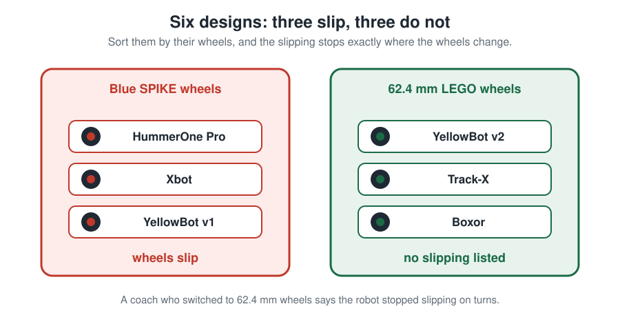{ loading=lazy }

**The design rules we took from them, and our robot.**

| Design rule | Why it matters | Our robot |
| --- | --- | --- |
| **One base, many attachments** | Get one base reliable, then only build attachments. Every change to the base breaks everything built on it. | One driving base, and the BOXOR frame with arms we swap. See section 2. |
| **A box frame lines you up** | Pushed flat against a wall, a box can only sit square. | Yes: a box with straight walls. See section 1. |
| **Weight low and even** | Weight up high makes the robot rock. Weight all at one end makes turns change from run to run. | The hub lies flat. Team to answer: is the weight low and even? |
| **Hold the wheels straight** | A wheel held on one side only bends inwards under a heavy attachment, and the robot curves. | Yes: the wheels sit inside the frame. See section 1. |
| **Attachments drop on** | A match is two and a half minutes. Every second spent swapping is a second not scoring. | Yes: gravity mounting. See section 2. |
| **The gyro does the driving** | Hold the heading with the gyro, count distance with the encoders. Timing is never repeatable. | Yes: `drive_cm` and `face`. See section 3. |
| **Grippy wheels** | The three designs that list no slipping all use 62.4 mm wheels. | Our code expects 62.4 mm wheels. Team to answer: check the real wheels. |

!!! question "Team to answer"
    - Which of the six designs is our driving base closest to?
    - Which idea did we take from which design?
    - Which rule did we decide **not** to follow, and why? For example, the
      slides say "attachments on top and front", but ours is on the back.

!!! tip "Say it to a judge: What resources did you use?"
    **Weak:** "We looked online."

    **Strong:** "Before we built anything, we compared six robot designs other
    teams had made, and what went wrong for each one. We noticed the three that
    slipped all used the blue SPIKE wheels. So we took the best ideas, like a
    box frame and gravity mounting, and built our robot from those."

## 1. The driving base

The **driving base** is the main part of the robot: the hub, the two wheels and
their motors. The attachments go on top of it.

**The shape: a box with straight walls.** Our driving base is a box. Its outside
walls are straight and flat, with nothing sticking out of the sides.

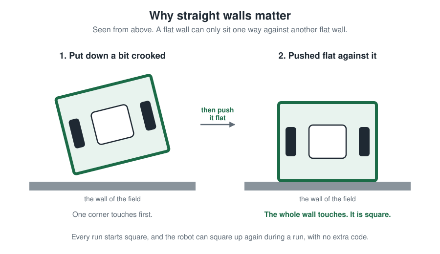{ loading=lazy }

Here is why that matters. Push a flat wall against another flat wall, and it
can only sit one way: square. So:

- **Every run starts square.** Push the robot back against the wall of the
  field, and it points the same way every time. No measuring, no code.
- **The robot can square up again during a run.** It backs gently into a wall
  or a model, and that pushes it straight. Our code does this, because nothing
  else fixes how *far* the robot has gone (see "How the robot finds its way"
  below).

A robot with round corners or bits sticking out would sit a little differently
every time.

**The wheels are inside the frame.** You can't see the wheels from the side,
because the frame goes around them. That helps in three ways:

- When the robot pushes against a wall or a model, the **frame** touches it,
  not a wheel. A wheel rubbing on something would steer the robot off course.
- The wheels can't catch on a model and knock it over.
- Each wheel is held on **both sides**: the motor on one side, the frame on the
  other. A wheel held on one side only can bend inwards under a heavy
  attachment, and then the robot stops driving straight.

!!! tip "Say it to a judge: Why is your robot shaped like that?"
    **Weak:** "It's a box."

    **Strong:** "Our robot is a box with flat walls and the wheels inside. When
    we push it back against the wall, it can only sit square, so every run
    starts the same way. It can square up on a wall during a run too. And the
    wheels can't rub on anything and steer us off course."

**What is plugged in where.** The hub has six sockets, called A to F. This is
how our robot is wired in the final code:

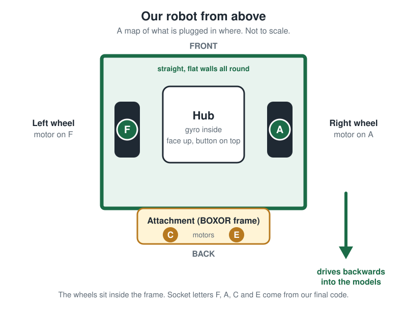{ loading=lazy }

| Socket | What is plugged in |
| --- | --- |
| F | Left wheel motor |
| A | Right wheel motor |
| C | Attachment motor (`attachment1`) |
| E | Attachment motor (`attachment2`) |

It took us three tries to get this right. On 13 September we read the sockets
off the hub and wrote them into the code. On 20 September the robot stopped
with an error that means "there is no motor in that socket". We tried again,
and the wheel motors worked on F and A. Later, someone wrote `confirmed :D`
next to socket E in `Phase 5.py`. A mistake, a test, and a fix: that is a good
story for ITERATE.

**How the robot finds its way.** The robot cannot see. It uses two things to
know where it is:

- The **gyro** is a sensor inside the hub. It knows which way the robot is
  pointing.
- The **motor encoders** count how far each wheel has turned, so the robot
  knows how far it has driven.

Our robot also had two **colour sensors**, which can follow the black lines on
the mat. On 20 September the team decided not to use them, and that code was
removed.

That choice has a downside. The gyro can fix which way the robot *points*, but
nothing fixes how *far* it has gone. So sometimes the robot backs gently into a
wall or a model, and that pushes it straight again.

**The hub** lies flat and face up. That way, you can press the big button with
one hand at the table.

**The wheels.** The code expects wheels that are 62.4 mm across. Nobody has
measured them yet to check.

!!! question "Team to answer"
    - Why did we pick this driving base? (See
      [How we chose our design](#how-we-chose-our-design) above.)
    - Which wheels are on the robot, and why those?
    - Why did we stop using the colour sensors?
    - Where is the heaviest part of the robot? Does it wobble when it stops?
    - Which wall do we push the robot against at the start of each run?
    - Was the robot always a box, or did an earlier version have bits sticking
      out? Do we have a photo?

## 2. Attachments

**Attachments** are the parts we add to the driving base to do the missions,
like arms that push, lift or pull.

**The BOXOR frame.** Our attachment frame comes from a published design, called
the BOXOR Frame Attachment. Inside it is a **bevel gear pair**:
two gears that meet at a corner. When the motor turns, the gears turn the
movement around the corner, through 90 degrees, and that swings an arm. Put a
different arm on, and the same frame can do a different job.

<figure markdown="span">
  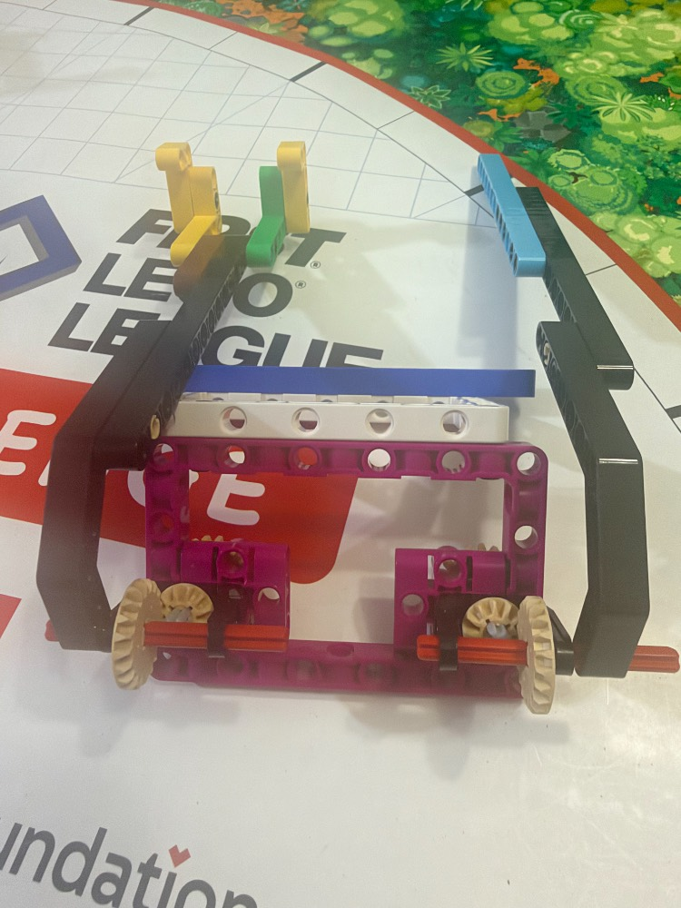{ width="420" loading=lazy }
  <figcaption>The BOXOR frame. The tan gears near the bottom are the bevel gears.</figcaption>
</figure>

Starting from someone else's design is allowed. The CREATE row says "original
designs **or improved on existing ones**". So don't say "we made it all up
ourselves". Say "we started with this design, and this is what we changed, and
why".

**Gravity mounting.** Our attachments are not clipped or pinned on. They sit on
the robot and are held by their own weight.

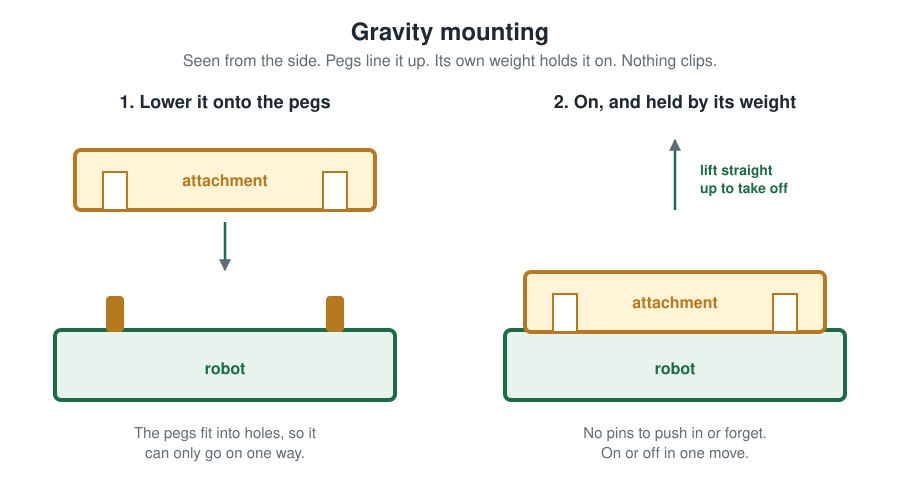{ loading=lazy }

- **Pegs line it up.** Small pegs on the robot fit into holes in the
  attachment, so it can only go on one way: the right way.
- **Gravity holds it.** Its weight keeps it down. Nothing clamps it.
- **On or off in one move.** You lower it on, or lift it off. There are no
  pins to push in, and none to forget when you're in a hurry at the table.

This matters because the match clock keeps running while we swap attachments
in base. Every second spent swapping is a second the robot is not scoring.

!!! tip "Say it to a judge: How do you change attachments?"
    **Weak:** "We just put them on."

    **Strong:** "We use gravity mounting. Pegs line the attachment up so it
    can only go on the right way, and its own weight holds it. It goes on or
    off in one move, so we waste less match time in base."

**Where it goes.** In the final code, the attachment is on the **back** of the
robot. That is why the robot drives backwards into most models, and why so many
distances in the code have a minus sign.

**Photos.** There are 11 photos of the final attachments, taken on 8 November.
Five of them are on this page. Open the box below to see more.

??? note "More attachment photos"
    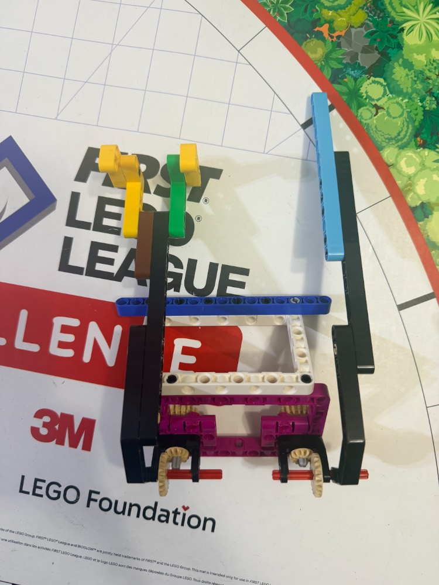{ width="360" loading=lazy }

    The same frame from another side.

    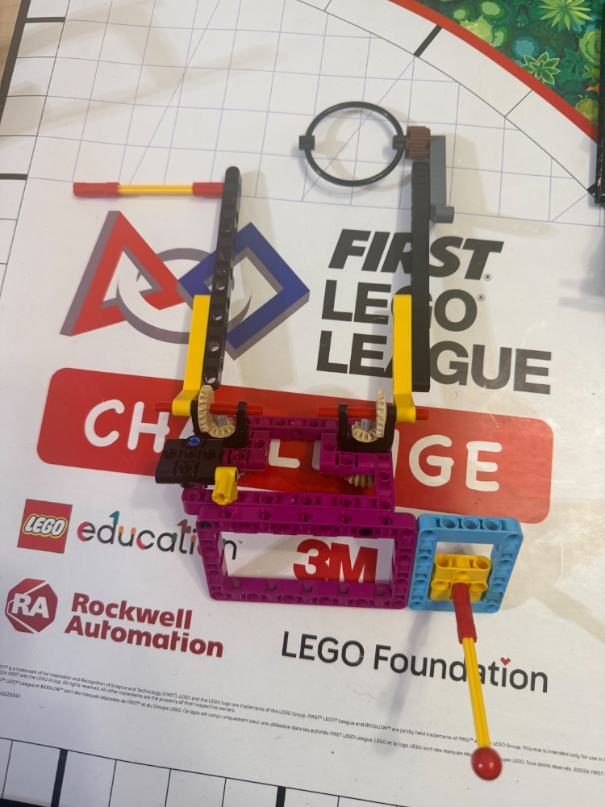{ width="360" loading=lazy }

    An attachment with a ring and red tips.

    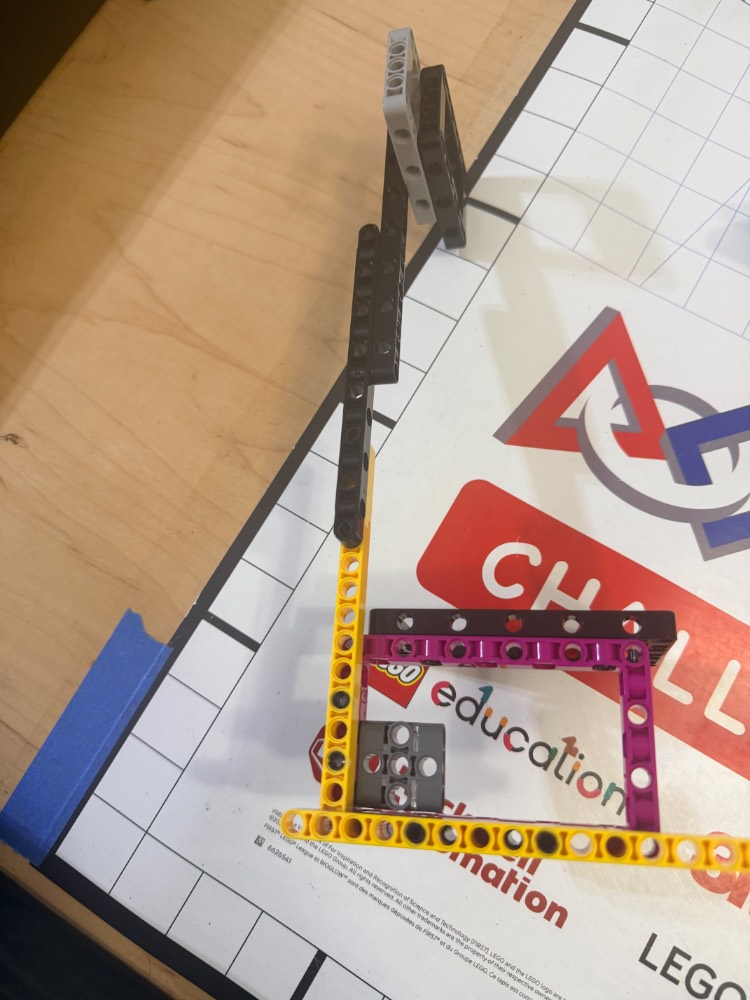{ width="360" loading=lazy }

    A long L-shaped arm.

    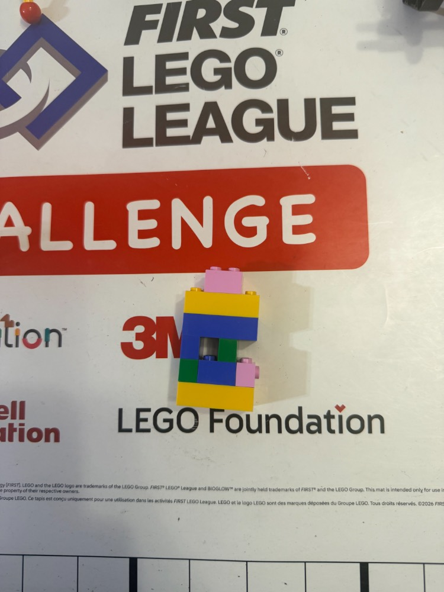{ width="300" loading=lazy }

    A small brick part. What is it for?

!!! question "Team to answer"
    - What did we change from the BOXOR instructions? Every change is a CREATE
      answer.
    - How many different arms do we have? Which mission uses each one?
    - How long does it take to swap an attachment? Time it with a stopwatch.
    - How many pegs hold each attachment, and where are they?
    - Has an attachment ever fallen off during a run? What did we change?
    - Why did we put the attachment on the back of the robot?

## 3. The code

**Why Python.** At the start of the season we used Word Blocks, the
drag-and-drop blocks in the SPIKE app. Then we moved to Python, which is typed
code. Last year's team left us good Python code to start from. Also, with
Python, git can show us exactly which line changed and when.

**Our library.** A **library** is a set of commands we wrote once and use in
every program. Ours is called `advanced.py`. It started as a copy of a Word
Blocks library called "Advanced Coding 26". When the team turned the blocks
into Python, they found **eight bugs** just by reading the blocks, and three
more by testing on the robot. They fixed all eleven. Two examples:

- The blocks used 3.146 for pi. The real value starts 3.14159.
- In the line-following blocks, the robot could wait for a line forever. If it
  missed the line once, it would sit still for the rest of the match.

**The main commands.**

| Command | What it does |
| --- | --- |
| `drive_cm(30)` | Drives 30 cm forwards. It speeds up gently, slows down gently, and uses the gyro to stay straight. `drive_cm(-30)` drives backwards. |
| `face(90)` | Turns until the robot points 90 degrees away from the way it pointed when the program started in base. |
| `motor.run_for_degrees(attachment2, -380, 1000)` | Turns an attachment motor 380 degrees backwards, at speed 1000. |
| `init_robot(default_speed=500)` | Starts the program. It resets the gyro to zero, so the way the robot points at the start becomes "base". |

**Why we use `face`.** Imagine you turn, and you are one degree off. If the next
turn starts from there, you are still one degree off, and the mistakes add up.
`face` always measures from base, the way the robot pointed at the start. So a
small mistake in one turn does not get passed on to the next turn. Our code
notes say: drive round a square with `face`, and you end about 1 degree off.
Without it, you can end 17 degrees off.

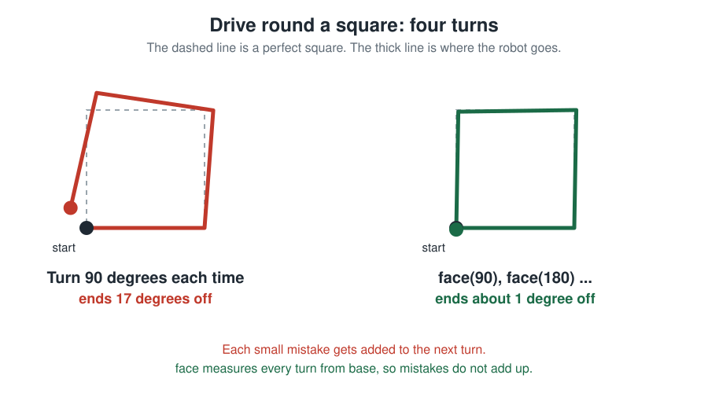{ loading=lazy }

**Why we use the gyro to turn.** The old turn just counted how far the wheels
turned. The team timed and measured both:

| | Time | How far off |
| --- | --- | --- |
| Old turn (counting wheels) | 1.54 seconds | 4.26 degrees |
| Gyro turn | 1.18 seconds | 0.58 degrees |

The gyro turn was faster *and* more accurate, so we deleted the old one.

**`YAW_SIGN = -1`.** This line tells the code which way the gyro counts. Ours
counts up when the robot turns anticlockwise. We found out on 20 September,
when `drive_cm(-44)` should have driven backwards, but the robot spun round on
the spot instead. The Word Blocks had this the wrong way round.

**The safety stop.** If the robot goes more than 45 degrees off course while
driving straight, it brakes and stops with an error. Before we added this, a
wrong setting made the robot spin and spin, because the code thought the
spinning was driving forwards.

**The calibration line.** Most programs have `set_calibration_scale(179/180)`.
We asked the robot to drive 180 cm, and it drove 179 cm. This line fixes every
distance to match our real robot.

**Centimetres, not millimetres.** Word Blocks used millimetres. Our Python uses
centimetres. So `.Forward 300` in blocks is the same as `drive_cm(30)` in
Python.

**Want to go deeper?** [How Our Code Is Designed](how-our-code-works.md) has
flowcharts of `drive_cm` and `face`, the safety stops, and how we test.

!!! question "Team to answer"
    - Who wrote which program? Add it to [who did what](../docs/who-did-what.md).
    - Which bug was the hardest to find? How did you find it?
    - What would you explain first to a judge who has never seen Python?

## 4. Mission strategy and the runs

A **run** is one trip from base onto the field and back. Our final programs are
in `code/Phases/Final/`. Here is what each one does:

| Program | What it does |
| --- | --- |
| `phase0.py` and `phase0-alt.py` | **M03 Flip the Rock**: backs 44 cm into the rock. Then **M02 Exploding Seeds**: turns, backs up, and uses the attachment. `phase0-alt.py` also straightens up after hitting the rock (see section 5). |
| `phase1.py` and `phase2.py` | Right now these are copies of `phase0-alt.py`. Ask the coach. |
| `phase3.py` | Turns to face "the root", lowers the attachment, and drives back while lifting it. That is **M05 Reaching Roots**. Then it drives across to the right side. |
| `Phase 5.py` | Four jobs in one run. The code calls them "Pull", "open door", "ant" and "Tree support". Then it drives back to base. |
| `Phase 6.py` | **M13 Keystone Species**, then back to base. |

FIRST gives some advice for choosing missions. Pick missions that need simple
moves like push, pull or lift. Pick missions close to where the robot starts,
and easy to get home from. (It is on our [strategy page](../robot-game/strategy.md).)

!!! question "Team to answer"
    - The `phase0.py` notes say "Missions 3, 2 and 1", but the code only does 3
      and 2. Does the robot also do M01 Drone Survey in this run?
    - Which mission numbers are "Pull", "open door", "ant" and "Tree support"?
    - Which missions did we decide **not** to do, and why? "It was too hard" is
      a weak answer. "It was only 10 points and took 40 seconds" is a strong
      one.
    - Why did we group the missions into runs this way?
    - What is our best score in practice?

## 5. Testing and changing things

The ITERATE row wants to see that we tested, found problems, and fixed them.
Git keeps a record of every change, so we can see our story:

| When | What happened |
| --- | --- |
| 13 Sep | Fixed the wrong sockets in the code. Found that our pretend mat on the computer was 236 cm wide, but the real mat is 200 cm. |
| 20 Sep | Found the gyro counted the other way (`YAW_SIGN`). Found the wheel motors were on F and A. Stopped using the colour sensors. |
| 26 Sep | Fixed a bug when the gyro goes past 180. It jumps to -179, and some turns spun for 30 seconds. |
| 10 to 11 Oct | Wrote the first run programs. Fixed the curved turn, then tuned the paths. |
| 25 to 31 Oct | Wrote programs for the right side of the field, including Keystone Species. |
| 1 Nov | Wrote the first versions of the final programs. |
| 7 to 13 Nov | Tuned the final programs. |

**Tuning you can see in the code.** Lots of lines have a note like `#was 60`.
Each one is a number someone changed after a test run. Here are some from
`Phase 5.py`:

- `await drive_cm(14) #was 12`
- `await face(-62) #was 60`
- `await drive_cm(-28) #was 30`
- `motor.run_for_degrees(port.C,360,1000) #was 350`

**A fix from testing.** In M03, the robot backs into the rock. The bump knocks
it a little crooked. So `phase0-alt.py` adds `await face(0)` right after the
bump, to straighten up. The note in the code says "Straighten post collision
before backing off for accuracy". We tested, found a problem, and fixed it.
That is exactly what ITERATE means.

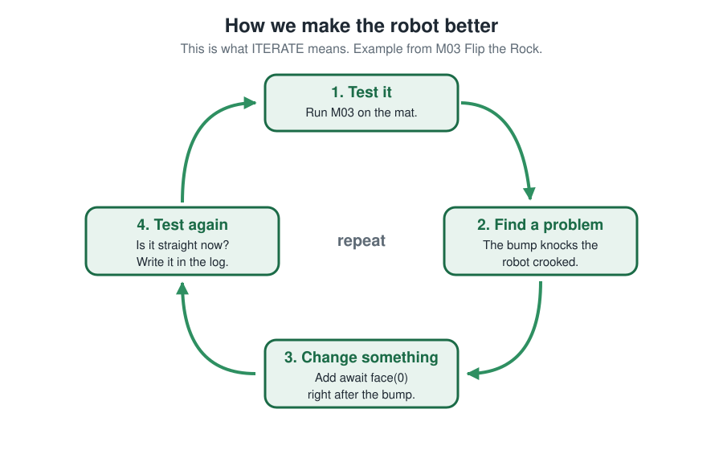{ loading=lazy }

Note: our [design log](design-log.md) only has two entries, both from September.
Everything since then is in git and in our memories. We will write it up at the
brainstorm.

!!! question "Team to answer"
    - Pick one `#was` line. Who changed it, and what went wrong before?
    - How often does each run work? For example, "8 out of 10 times".
    - What is the biggest change we made to the robot itself, not the code?
      Do we have a photo of how it looked before?

## 6. Words to know

**Attachment.** A part we add to the robot to do a mission, like an arm.

**Base.** The way the robot points when the program starts. Every `face` turn
is measured from base.

**Bevel gears.** Two gears that meet at a corner, so the turning movement goes
around the corner.

**Calibration.** Measuring what the real robot does, then changing the code to
match, like `set_calibration_scale(179/180)`.

**Driving base.** The main part of the robot: the hub, wheels and motors.

**Encoder.** The part inside a motor that counts how far it has turned.

**Gravity mounting.** Holding an attachment on with its own weight, lined up by pegs, instead of clips or pins.

**Gyro.** The sensor inside the hub that knows which way the robot points.

**Iterate.** Test it, find a problem, change something, and test again.

**Library.** Commands we wrote once and use in every program.

**Rubric.** The judges' score sheet.

**Run.** One trip from base onto the field and back.

**Squaring up.** Pushing the robot's flat side against a wall, so it points exactly straight.

**Yaw.** The direction the robot points, as a number of degrees.

## Next

When you have read everything, take the [Robot Design test](robot-design-test.md).

--8<-- "includes/abbreviations.md"
